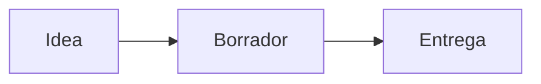

# Live Preview: escribir viendo el resultado

Apretá **`Ctrl+Shift+L`** (o el botón 🎯 hasta llegar a *Live Preview*). Esta nota se va a ver **como en modo lectura**, pero podés escribir en ella: solo la línea donde está el cursor muestra el Markdown.

## Probá mover el cursor por acá

Texto con **negrita**, *cursiva*, ~~tachado~~, `código` y ==resaltado==. Un [enlace](https://example.com), una nota [[formato-avanzado]] y una #etiqueta.

- Una lista con viñetas
- Otra línea
  - Y una sangría

- [ ] Una tarea: hacé clic en la casilla (en Live Preview se tilda directo)
- [x] Una tarea hecha

> Una cita: al poner el cursor acá aparece el `>`.

La fórmula $E = mc^2$ va en la línea, y esta en bloque:

$$\int_0^1 x^2\,dx = \frac{1}{3}$$

| Materia | Parcial | Final |
|---|---|---|
| Álgebra | 8 | 7 |
| Historia | 6 | 9 |

---

> [!NOTE]
> Los callouts también se dibujan. Clic adentro para editarlo.

Para volver: `Ctrl+Shift+L` otra vez. Guía: [`../Guias/modos-de-vista.md`](../Guias/modos-de-vista.md).
