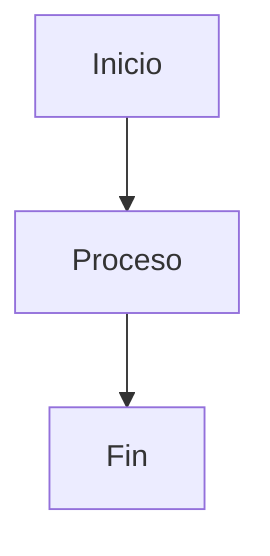

# Manual de uso — MK

Guía completa de cómo usar MK. Para instalar/correr la app ver [`README.md`](./README.md); para saber qué está hecho y qué no, [`ESTADO.md`](./ESTADO.md).

> Esta guía se actualiza cada vez que se agrega una función nueva a MK — si ves algo en la app que no está acá, avisá.

## Índice

1. [Primeros pasos](#1-primeros-pasos)
2. [El editor y las pestañas](#2-el-editor-y-las-pestañas)
3. [Formato Markdown](#3-formato-markdown)
4. [Fórmulas matemáticas (LaTeX)](#4-fórmulas-matemáticas-latex)
5. [Imágenes, vídeo y PDF](#5-imágenes-vídeo-y-pdf)
6. [Etiquetas y wikilinks](#6-etiquetas-y-wikilinks)
7. [El sidebar: organizar tus archivos](#7-el-sidebar-organizar-tus-archivos)
8. [Buscar cosas](#8-buscar-cosas)
9. [Nota diaria](#9-nota-diaria)
10. [Tablero Kanban](#10-tablero-kanban)
11. [Grafo de notas](#11-grafo-de-notas)
12. [Historial de versiones](#12-historial-de-versiones)
13. [Modos de vista](#13-modos-de-vista)
14. [Personalizar MK](#14-personalizar-mk)
15. [Exportar](#15-exportar)
16. [Ver cambios sin guardar](#16-ver-cambios-sin-guardar)
17. [Menú contextual del editor](#17-menú-contextual-del-editor)
18. [Plugins y comunidad](#18-plugins-y-comunidad)
19. [Todos los atajos de teclado](#19-todos-los-atajos-de-teclado)

---

## 1. Primeros pasos

Al abrir MK por primera vez te encontrás con una pestaña en blanco. Tenés tres formas de empezar:

- **📁 Carpeta** (toolbar, arriba a la izquierda): abre una carpeta de tu sistema y la muestra como árbol en el panel izquierdo (el "sidebar"). Es la forma recomendada de trabajar — la mayoría de las funciones (etiquetas, backlinks, búsqueda, mover archivos) necesitan una carpeta abierta para tener sentido.
- **📄 Nuevo ▾**: crea una pestaña nueva. El desplegable trae plantillas listas — Markdown vacío, Apuntes, Documentación, Trabajo universitario, README, Fórmulas matemáticas — cada una con una estructura de encabezados típica para ese uso. Las plantillas (menos la vacía) tienen variables que se completan solas: `{{fecha}}` se reemplaza por la fecha de hoy, y si la plantilla usa `{{titulo}}` te pregunta el título antes de crear el documento.
- **Abrir**: abre un único archivo (`.md`, `.markdown`, `.txt`, `.tex`, o cualquier otro con "Todos los archivos") con el diálogo nativo del sistema.

MK recuerda la última carpeta que abriste y la vuelve a mostrar automáticamente la próxima vez que abrís la app, junto con todas las pestañas que tenías abiertas (con o sin guardar).

También podés hacer doble clic en un `.md`/`.tex` desde el explorador de archivos de tu sistema para que se abra directo en MK.

## 2. El editor y las pestañas

El editor (columna del medio) es donde escribís. A la derecha se ve el **preview**: el resultado renderizado, actualizado en vivo mientras escribís.

- Podés tener **varias pestañas abiertas** a la vez (fila arriba del editor). Un punto (`●`) junto al nombre indica cambios sin guardar.
- `Ctrl+W` cierra la pestaña activa (pide confirmación si tiene cambios sin guardar). `Ctrl+Tab` / `Ctrl+Shift+Tab` cicla entre pestañas.
- **Autoguardado**: por defecto guarda cada 1 segundo, pero solo si la pestaña ya tiene una ruta en disco (una pestaña "Sin título" no se autoguarda hasta que la guardes vos una vez). Podés cambiar el intervalo o desactivarlo del todo desde ⚙ **Ajustes** → *Autoguardado*.
- Si cerrás MK con cambios sin guardar, al volver a abrirla te pregunta si querés **restaurar** esos cambios o **descartarlos** y volver a la versión guardada en disco.
- Los archivos `.tex` se abren automáticamente con resaltado de sintaxis LaTeX en vez de Markdown.

**Autocompletado**: mientras escribís, MK sugiere palabras que ya usaste antes en el mismo documento (no es un diccionario ni completa sintaxis Markdown, solo palabras repetidas). Aparece solo después de 2 letras o más, o lo podés forzar vos con `Ctrl+Space`.

**Corrector ortográfico** — no hay que activarlo, ya está prendido:

1. Escribí normal. Cualquier palabra que el sistema no reconozca queda subrayada con una línea ondulada roja, en el momento.
2. Clic derecho justo sobre la palabra subrayada: si el sistema tiene sugerencias, aparecen como botones arriba del [menú del editor](#17-menú-contextual-del-editor) (hasta 5) — clic en una la reemplaza en el texto.
3. Si no es un error, sino una palabra tuya que el diccionario no conoce (un nombre propio, jerga técnica): usá el botón "Agregar '...' al diccionario" que aparece junto a las sugerencias — no vuelve a subrayarla.

Las sugerencias tardan un instante en aparecer (llegan async del corrector nativo del sistema) — si abrís el menú y hacés clic muy rápido antes de que carguen, no vas a ver botones de sugerencia todavía, solo el menú base.

**Snippets de texto** — abreviaturas que se expanden solas:

1. En cualquier parte del editor, escribí `/` seguido de una palabra (sin espacios), por ejemplo `/fecha`.
2. Apretá espacio, Enter o Tab justo después.
3. El texto `/fecha` desaparece y se reemplaza por el valor de hoy (ej. `9/9/2026`).

Vienen dos ya cargados: `/fecha` (fecha de hoy) y `/hora` (hora actual, HH:MM) — estos dos son "vivos", cambian según el momento en que los usás. Para agregar los tuyos propios (texto fijo, no cambia):

1. Abrí ⚙ **Ajustes** (toolbar).
2. En el cuadro de texto "Snippets de texto", escribí una línea por abreviatura, formato `/abrev = texto a insertar`. Ejemplo:
   ```
   /firma = Saludos, Juli
   /msj = Gracias por tu mensaje, te respondo a la brevedad.
   ```
3. Hacé clic afuera del cuadro (o Tab) para que se guarde — queda para siempre, no hace falta repetirlo cada vez.
4. Probalo: escribí `/firma` en el editor y apretá espacio.

**Índice del documento**: botón ☰ en la toolbar, o `Ctrl+Shift+O`. Abre un panel flotante con todos los encabezados del documento activo (organizados por nivel, H1/H2/H3); clic en uno hace scroll directo hasta ahí en el preview.

## 3. Formato Markdown

MK soporta Markdown estándar — encabezados (`#`, `##`, `###`...), **negrita** (`**texto**`), *cursiva* (`*texto*`), listas, citas (`>`), y además:

**Tablas**, con estilo automático (encabezado resaltado, filas alternadas):

```markdown
| Columna 1 | Columna 2 |
| --------- | --------- |
| dato      | dato      |
```

**Bloques de código**, con resaltado de sintaxis automático según el lenguaje:

````markdown
```js
const x = 1;
```
````

**Ejecutar código JavaScript** — un bloque ```` ```js ```` (o ```` ```javascript ````) tiene un botón **"▶ Ejecutar"** debajo, en el preview:

1. Escribí tu código en el bloque, en el editor.
2. Andá al preview y hacé clic en "▶ Ejecutar" debajo de ese bloque.
3. Debajo del botón aparece la salida: todo lo que imprimiste con `console.log(...)`, y además el valor de la última línea si es una expresión suelta (estilo "notebook" — no hace falta escribir `return`). Ejemplo:
   ````markdown
   ```js
   console.log("suma parcial:");
   2 + 2
   ```
   ````
   da como salida `suma parcial:` seguido de `=> 4`.

Corre en un **Web Worker** nuevo por cada ejecución: sin acceso a `window`, a tus archivos ni al resto de MK — aislado de verdad, no una promesa vacía. Si el código no termina, se corta solo a los 3 segundos. Solo JavaScript por ahora, no otros lenguajes (correr Python u otros exigiría lanzar un proceso real del sistema, un salto de riesgo que se dejó afuera a propósito).

**Callouts** (recuadros destacados para notas, avisos, etc.):

```markdown
> [!NOTE]
> Esto es una nota.

> [!TIP]
> Un consejo.

> [!WARNING]
> Cuidado con esto.

> [!IMPORTANT]
> Algo importante.

> [!CAUTION]
> Algo serio.
```

Cada tipo tiene su propio color e ícono en el preview.

**Diagramas** — un bloque de código con lenguaje `mermaid` se renderiza como diagrama en vez de mostrarse como texto:

````markdown

````

No hace falta instalar ni activar nada — basta con escribir el bloque, y en el preview aparece dibujado en vez de mostrarse como texto. Soporta lo que soporta [Mermaid](https://mermaid.js.org) — diagramas de flujo (`graph`), de secuencia (`sequenceDiagram`), Gantt (`gantt`), y más. **Límite:** el fondo del diagrama es blanco fijo, no se adapta a los 26 temas de color de MK — si usás un tema oscuro, igual vas a ver el diagrama sobre fondo blanco.

## 4. Fórmulas matemáticas (LaTeX)

Se renderizan con KaTeX:

- **Inline**: `$x^2 + y^2 = z^2$` → se muestra dentro del párrafo.
- **En bloque**: `$$\sum_{i=1}^n x_i$$` → se muestra centrada, más grande.

Los archivos `.tex` completos también se editan con resaltado de sintaxis LaTeX (no Markdown) — útil si estás escribiendo un documento LaTeX entero, no solo fórmulas sueltas dentro de una nota.

## 5. Imágenes, vídeo y PDF

**Imágenes**, con Markdown normal — las rutas relativas se resuelven contra la ubicación del archivo actual:

```markdown

```

**Vídeo y PDF embebidos**, con una sintaxis propia (dos corchetes):

```markdown
![[video.mp4]]
![[documento.pdf]]
```

**Formas de insertar estos elementos sin escribir la sintaxis a mano:**

- **Arrastrar y soltar** un archivo desde el explorador de tu sistema al editor: lo copia a una carpeta `assets/` junto al archivo actual e inserta el Markdown correspondiente automáticamente.
- **Arrastrar una fila del sidebar** (un archivo que ya está en tu carpeta abierta) directo al editor: inserta el link/embed apuntando a donde ya está el archivo, sin copiarlo de nuevo.
- Desde el [menú contextual](#17-menú-contextual-del-editor) del editor: "Insertar imagen".

**Ver una imagen o un PDF sueltos**: hacé clic en el archivo desde el sidebar (no hace falta que esté referenciado en ningún `.md`) — se muestra a pantalla completa en el panel de preview. Con un PDF podés navegarlo con el visor nativo; con una imagen, se centra y ajusta al espacio disponible.

## 6. Etiquetas y wikilinks

Pensadas para organizar y conectar notas dentro de una misma carpeta (estilo Obsidian/Roam).

**Etiquetas** — escribí `#` pegado a una palabra en cualquier parte del texto:

```markdown
Esta nota es sobre #proyecto y #urgente.
```

Se muestran como una "pill" resaltada en el preview. (Un `## Encabezado` nunca se confunde con etiqueta — el `#` de etiqueta no puede tener otro `#` justo antes.)

- **Ver todas las etiquetas de la carpeta**: botón 🏷 en la toolbar, o `Ctrl+Shift+T`. Lista cada etiqueta con cuántas veces aparece en total; hacer clic en una dispara una búsqueda global de esa etiqueta.

**Wikilinks** — enlace directo a otra nota por nombre de archivo, sin tener que escribir la ruta:

```markdown
Ver también [[Otra nota]]
[[Otra nota|con texto distinto al del link]]
```

Al hacer clic, MK busca un archivo con ese nombre en la carpeta abierta y lo abre. Si no lo encuentra, el link se marca visualmente como roto.

- **Backlinks** — "¿qué otros archivos enlazan a este?": botón 🔗 en la toolbar, o `Ctrl+Shift+B`, con el archivo que te interesa abierto y activo. Lista cada archivo que tiene un `[[Nombre]]` apuntando al actual, con la línea exacta; clic en un resultado te lleva directo ahí.

Los `#tag`/`[[wikilink]]` dentro de bloques de código (\`\`\`) o código inline (\`así\`) no se activan — se tratan como texto literal, no como etiquetas/links reales.

## 7. El sidebar: organizar tus archivos

Con una carpeta abierta, el panel izquierdo muestra el árbol de archivos:

- **Clic en una carpeta**: expande/colapsa. El ícono cambia entre carpeta cerrada y abierta.
- **Clic en un archivo**: lo abre (Markdown/LaTeX/texto en una pestaña; PDF/imagen a pantalla completa en el preview).
- **"↑ .."** arriba del todo: sube a la carpeta padre de la que tenés abierta, sin pasar por el diálogo de "Abrir carpeta".

**Clic derecho** en cualquier archivo, carpeta, o la raíz misma, abre un menú con:

- **Nuevo archivo... / Nueva carpeta...** (en carpetas y en la raíz): pide un nombre y lo crea ahí mismo.
- **Cambiar icono...**: abre un buscador sobre ~1500 íconos (los mismos [lucide](https://lucide.dev) que usa toda la app) para ese archivo en particular. "Quitar icono personalizado" vuelve al ícono automático según la extensión.
- **Renombrar...**
- **Eliminar**: pide confirmación; se manda a la papelera del sistema (se puede restaurar desde ahí) salvo que la papelera no esté disponible, en cuyo caso borra directo.

**Mover un archivo o carpeta**: arrastralo y soltalo sobre otra carpeta (o sobre la raíz, o sobre "↑ .." para subirlo un nivel). No se puede mover una carpeta dentro de sí misma.

Si renombrás o movés un archivo que tenías abierto en una pestaña, esa pestaña se actualiza sola para seguir apuntando al lugar correcto (así "Guardar" no crea un archivo viejo por error).

## 8. Buscar cosas

- **Búsqueda global** (🔍 en la toolbar, o `Ctrl+Shift+F`): busca un texto en todos los archivos de la carpeta abierta (`.md`, `.markdown`, `.txt`, `.tex`), hasta 200 resultados. Clic en un resultado abre el archivo y salta directo a esa línea.
- **Paleta de comandos** (⌘ en la toolbar, o `Ctrl+Shift+P`): lista todo lo que podés hacer en MK — nuevo, abrir, guardar, exportar, cambiar de tema, alternar vistas, ver etiquetas/backlinks/historial/Kanban/grafo — con filtro por texto a medida que escribís. Navegás con las flechas y confirmás con Enter.

## 9. Nota diaria

Pensada para llevar un diario o un registro rápido del día, sin tener que crear el archivo a mano cada vez.

1. Apretá `Ctrl+Shift+D`, o buscá "Nota diaria de hoy" en la paleta de comandos (`Ctrl+Shift+P`).
2. MK busca (o crea, si no existe todavía) el archivo `Diario/AAAA-MM-DD.md` con la fecha de hoy, dentro de tu carpeta abierta — por ejemplo `Diario/2026-09-09.md`.
3. Si es la primera vez que la abrís ese día, la crea con la fecha como encabezado; si ya escribiste algo hoy, la abre tal cual la dejaste.

El atajo siempre te lleva a la nota de *hoy* — para ayer o mañana hay que abrir el archivo a mano desde el sidebar (`Diario/2026-09-08.md`, etc.). Necesita una carpeta abierta (si no tenés ninguna carpeta abierta, no sabe dónde crear `Diario/`).

## 10. Tablero Kanban

Convierte cualquier documento con esta estructura en un tablero visual, sin archivos ni configuración aparte:

1. Escribí el documento con encabezados `## Nombre` como columnas, y una lista debajo de cada uno como tarjetas de esa columna.
2. Abrí la paleta de comandos (`Ctrl+Shift+P`) y elegí "Ver tablero Kanban".
3. Se abre el tablero con una columna por cada `##` y una tarjeta por cada ítem de lista.

Ejemplo de documento:

```markdown
## Por hacer
- [ ] Escribir el resumen
- [ ] Revisar ortografía

## Haciendo
- [ ] Armar la presentación

## Hecho
- [x] Investigar el tema
```

- **Clic en una tarjeta**: la marca/desmarca como hecha (tacha el texto y agrega/saca `[x]` en el Markdown real, ej. `- [ ] tarea` ↔ `- [x] tarea`).
- **Arrastrar una tarjeta a otra columna**: la mueve de verdad en el texto — MK reescribe el documento entero para reflejar el nuevo orden, así que si volvés a la vista de editor vas a ver la tarjeta ya bajo el otro `##`.

Todo se guarda en el mismo archivo — no hay una base de datos aparte, el tablero *es* el Markdown, es solo otra forma de verlo y editarlo. **Límite:** solo lee la pestaña activa, no combina tareas de varios archivos en un mismo tablero.

## 11. Grafo de notas

Mapa visual de qué nota enlaza con cuál, útil para ver de un vistazo cómo se conectan tus notas en una carpeta grande.

1. Escribí enlaces entre tus notas con la sintaxis `[[nombre del archivo]]` (ver [sección 6](#6-etiquetas-y-wikilinks)).
2. Abrí la paleta de comandos (`Ctrl+Shift+P`) y elegí "Ver grafo de notas".
3. MK escanea toda la carpeta abierta: cada archivo `.md` es un punto (nodo), y cada `[[wikilink]]` entre dos archivos es una línea que los conecta.
4. Clic corto en un nodo abre ese archivo directamente.

El acomodo inicial de los nodos es automático (se alejan entre sí, los conectados por un link se atraen entre sí) y se calcula una sola vez al abrir el grafo. Desde ahí podés moverte:

- **Zoom**: rueda del mouse — acerca/aleja centrado justo donde tenés el cursor, no al centro del panel.
- **Pan**: clic sostenido sobre el fondo (no sobre un nodo) y arrastrar, mueve todo el grafo.
- **Mover un nodo a mano**: clic sostenido sobre un nodo y arrastrar lo reacomoda; si soltás sin haberlo movido, se interpreta como el clic normal de "abrir archivo".

**Límite:** el reacomodo manual no se guarda — al cerrar y volver a abrir el grafo, vuelve a correr el layout automático desde cero.

## 12. Historial de versiones

Cada vez que se guarda un archivo (autoguardado incluido), MK respalda el contenido *anterior* antes de pisarlo — hasta 20 versiones por archivo, guardadas fuera del proyecto (en la carpeta de configuración de la app, no junto a tus notas).

Para ver o recuperar una versión anterior: paleta de comandos → **"Ver versiones anteriores..."**. Elegís una fecha/hora de la lista y su contenido reemplaza lo que tenés en el editor (podés deshacer con `Ctrl+Z` si te arrepentís, antes de guardar).

## 13. Modos de vista

- **🎯 Modo enfoque / lectura** (botón en la toolbar, o `Ctrl+Shift+E` / `Ctrl+Shift+R`): el mismo botón cicla entre tres estados — normal, enfoque (solo editor, sin sidebar ni preview) y lectura (solo preview).
- **`F11` — pantalla completa / escritura sin distracciones**: pone la ventana en pantalla completa real y oculta la toolbar y la barra de estado, dejando solo sidebar/editor/preview según el modo en que estés. Volvés a pulsar `F11` para salir.

## 14. Personalizar MK

Desde ⚙ **Ajustes**:

- **Autoguardado**: desactivado, cada 1s, cada 5s, cada 30s.
- **Tamaño de fuente** del editor: 12 a 18px.
- **Tipografía** del editor: JetBrains Mono, Fira Code, Consolas, o la monoespaciada del sistema.
- **Ancho de tabulación**: 2, 4 u 8 espacios.
- **Ajuste de línea**: activar/desactivar el word-wrap.
- **Snippets de texto**: tus abreviaturas propias (ver [sección 2](#2-el-editor-y-las-pestañas)).
- **Sincronizar con git al guardar** (apagado por defecto): commitea sola cada guardado manual, para tener un historial de versiones real sin escribir `git commit` a mano.
  1. Activá el toggle en Ajustes.
  2. Requisito: la carpeta abierta ya tiene que ser un repositorio git (con `git init` hecho de antes, a mano o desde otro programa) — **MK nunca corre `git init` por vos**, y si la carpeta no es un repo, la opción simplemente no hace nada.
  3. De ahí en más, cada `Ctrl+S` (o clic en Guardar) hace `git add -A` + `git commit` con un mensaje genérico automático.
  4. No se dispara con el autoguardado (solo con guardado manual), para no llenar el historial con commits cada 1-30 segundos.
  - **Límite:** no hay control fino — siempre agrega todos los archivos cambiados (`git add -A`) y usa un mensaje automático, no se puede elegir qué incluir ni escribir tu propio mensaje desde MK.

Desde 🎨 **Tema**: 26 temas de color — Claro, Oscuro, y 24 más conocidos (Dracula, Nord, Gruvbox, Monokai, Solarized, One Dark Pro, Tokyo Night, Catppuccin, Rosé Pine, GitHub Dark/Light, y otros). Se guarda tu elección para la próxima vez.

Todos estos ajustes se guardan automáticamente y se recuerdan entre sesiones.

## 15. Exportar

Desde ⬇ **Exportar**:

- **A HTML**: un archivo `.html` standalone (con el CSS embebido adentro), que se puede abrir en cualquier navegador sin depender de MK.
- **A PDF**: renderizado directo a PDF.
- **A EPUB**: genera un libro electrónico válido a partir del documento activo, para abrir en cualquier lector de EPUB (Calibre, tu e-reader, etc.). Elegís "A EPUB" en el menú Exportar, elegís dónde guardar el `.epub`, y listo. **Límite:** el documento entero se mete como un único capítulo — no arma un libro con varios archivos como capítulos separados, y no tiene portada.
- **A tarjetas de memoria (Anki)**: pensado para convertir apuntes en tarjetas de estudio.
  1. Escribí el documento con un encabezado `## Pregunta` por cada tarjeta que querés crear; todo el texto hasta el próximo `##` es la respuesta (el "dorso") de esa tarjeta. Ejemplo:
     ```markdown
     ## ¿Capital de Francia?
     París.

     ## ¿Capital de Japón?
     Tokio.
     ```
  2. Elegís "A tarjetas de memoria (Anki)" en el menú Exportar — genera un `.txt` de dos columnas separadas por tabulador (Frente/Dorso), una fila por cada `##`.
  3. En Anki: *Archivo → Importar*, elegís ese `.txt`, y en las opciones de importación poné el separador en "Tabulador". Cada fila se vuelve una tarjeta nueva.

Las fórmulas matemáticas y el resaltado de código se ven un poco distintos al exportar (una hoja de estilos simplificada, no la de la app) — es un compromiso consciente para no tener que arrastrar fuentes/librerías completas al archivo exportado.

## 16. Ver cambios sin guardar

Botón 🔀 en la toolbar: compara el contenido actual del editor contra la última versión guardada en disco de ese mismo archivo, línea por línea — verde lo agregado, rojo lo borrado. Necesita que el archivo ya tenga una versión guardada en disco con la que comparar.

## 17. Menú contextual del editor

Clic derecho dentro del editor:

- **Copiar / Cortar / Pegar / Seleccionar todo**
- **Insertar título (H2)**
- **Insertar tabla**
- **Insertar enlace**
- **Insertar imagen**
- **Insertar bloque de código**
- **Insertar cita / callout**

Cada inserción deja el cursor listo para seguir escribiendo en el lugar justo (por ejemplo, "Insertar enlace" selecciona la parte de la URL para que la pegues encima).

## 18. Plugins y comunidad

Botón 🧩 en la toolbar (o desde la paleta de comandos): MK todavía no tiene un sistema real de plugins de terceros (es una decisión de seguridad consciente: cargar código ajeno en una app con acceso a tus archivos no es algo para improvisar). Todo lo que había en la lista de ideas de este panel ya se implementó como función propia de la app (corrector ortográfico, snippets, plantillas con variables, nota diaria, diagramas Mermaid, grafo, Kanban, exportar a EPUB/Anki, sincronizar con git, ejecutar código JS) — todas descritas en las secciones de arriba.

## 19. Todos los atajos de teclado

| Atajo | Acción |
|---|---|
| `Ctrl+N` | Nuevo documento |
| `Ctrl+O` | Abrir archivo |
| `Ctrl+S` | Guardar |
| `Ctrl+Shift+S` | Guardar como |
| `Ctrl+W` | Cerrar pestaña activa |
| `Ctrl+Tab` / `Ctrl+Shift+Tab` | Pestaña siguiente / anterior |
| `Ctrl+Shift+P` | Paleta de comandos |
| `Ctrl+Shift+F` | Búsqueda global |
| `Ctrl+Shift+T` | Etiquetas de la carpeta |
| `Ctrl+Shift+B` | Backlinks del archivo activo |
| `Ctrl+Shift+D` | Nota diaria de hoy |
| `Ctrl+Shift+O` | Índice del documento |
| `Ctrl+Shift+E` | Modo enfoque |
| `Ctrl+Shift+R` | Modo lectura |
| `F11` | Pantalla completa / escritura sin distracciones |
| `Ctrl+Space` | Autocompletado |
| `/fecha`, `/hora` + espacio/Enter/Tab | Snippets de texto (más los tuyos propios) |
| `Escape` | Cerrar el panel/menú/diálogo que esté abierto |

Tablero Kanban y grafo de notas no tienen atajo propio todavía — se abren desde la paleta de comandos (`Ctrl+Shift+P`).

Estos atajos funcionan sin importar qué parte de la app tenga el foco (editor, sidebar, buscador, etc.), no solo con el cursor en el editor.
