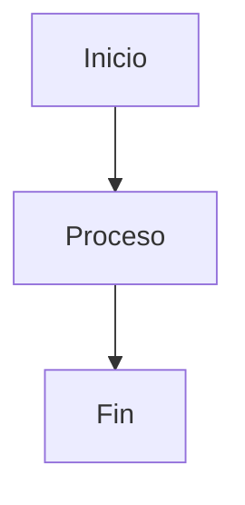

# Manual de uso — MK

Guía completa de cómo usar MK. Para instalar/correr la app ver [`README.md`](./README.md); para saber qué está hecho y qué falta, [`OBJETIVOS.md`](./OBJETIVOS.md); para una guía corta por función, [`Guias/`](./Guias/README.md); para una referencia rápida de atajos sin tanto texto, [`COMANDOS.md`](./COMANDOS.md).

> Esta guía se actualiza cada vez que se agrega una función nueva a MK — si ves algo en la app que no está acá, avisá.

## Índice

1. [Primeros pasos](#1-primeros-pasos)
2. [El editor y las pestañas](#2-el-editor-y-las-pestañas)
3. [Formato Markdown](#3-formato-markdown)
4. [Fórmulas matemáticas (LaTeX)](#4-fórmulas-matemáticas-latex)
5. [Imágenes, vídeo y PDF](#5-imágenes-vídeo-y-pdf)
6. [Etiquetas y wikilinks](#6-etiquetas-y-wikilinks)
7. [El sidebar: organizar tus archivos](#7-el-sidebar-organizar-tus-archivos)
8. [Buscar cosas](#8-buscar-cosas)
9. [Nota diaria](#9-nota-diaria)
10. [Tablero Kanban](#10-tablero-kanban)
11. [Grafo de notas](#11-grafo-de-notas)
12. [Historial de versiones](#12-historial-de-versiones)
13. [Modos de vista](#13-modos-de-vista)
14. [Personalizar MK](#14-personalizar-mk)
15. [Exportar](#15-exportar)
16. [Ver cambios sin guardar](#16-ver-cambios-sin-guardar)
17. [Menú contextual del editor](#17-menú-contextual-del-editor)
18. [Plugins y comunidad](#18-plugins-y-comunidad)
19. [Todos los atajos de teclado](#19-todos-los-atajos-de-teclado)
20. [Operaciones de páginas PDF](#20-operaciones-de-páginas-pdf)
21. [Subrayar texto en PDF](#21-subrayar-texto-en-pdf)
22. [Panel secundario (pantalla dividida)](#22-panel-secundario-pantalla-dividida)
23. [Temporizador Pomodoro](#23-temporizador-pomodoro)
24. [Controlar el reproductor multimedia](#24-controlar-el-reproductor-multimedia)
25. [Home: planificador semanal y mensual](#25-home-planificador-semanal-y-mensual)
26. [Bases de datos relacionales](#26-bases-de-datos-relacionales)
27. [Terminal integrada](#27-terminal-integrada)

> Guías especializadas por función (cómo usar / para qué sirve): carpeta [`Guias/`](./Guias/README.md).

---

## 1. Primeros pasos

Al abrir MK por primera vez te encontrás con una pestaña en blanco. Tenés tres formas de empezar:

- **📁 Carpeta** (toolbar, arriba a la izquierda): abre una carpeta de tu sistema y la muestra como árbol en el panel izquierdo (el "sidebar"). Es la forma recomendada de trabajar — la mayoría de las funciones (etiquetas, backlinks, búsqueda, mover archivos) necesitan una carpeta abierta para tener sentido.
- **📄 Nuevo ▾**: crea una pestaña nueva. El desplegable trae plantillas listas — Markdown vacío, Apuntes, Documentación, Trabajo universitario, README, Fórmulas matemáticas — cada una con una estructura de encabezados típica para ese uso. Las plantillas (menos la vacía) tienen variables que se completan solas: `{{fecha}}` se reemplaza por la fecha de hoy, y si la plantilla usa `{{titulo}}` te pregunta el título antes de crear el documento.
- **Abrir**: abre un único archivo (`.md`, `.markdown`, `.txt`, `.tex`, `.docx`, o cualquier otro con "Todos los archivos") con el diálogo nativo del sistema.

MK recuerda la última carpeta que abriste y la vuelve a mostrar automáticamente la próxima vez que abrís la app, junto con todas las pestañas que tenías abiertas (con o sin guardar).

También podés hacer doble clic en un `.md`/`.tex`/`.docx` desde el explorador de archivos de tu sistema para que se abra directo en MK.

**Abrir un `.docx`** — un `.docx` no es texto plano (es un `.zip` con XML adentro), así que MK lo convierte a Markdown antes de mostrarlo, en vez de abrirlo como si fuera un archivo de texto:

1. Abrilo con "Abrir", clic en el árbol del sidebar, o doble clic desde el explorador de archivos — cualquiera de los tres.
2. Se abre en una **pestaña nueva sin ruta** ("Sin título"), con el contenido ya convertido a Markdown.
3. Escribís/editás como cualquier otro documento. `Ctrl+S` te va a pedir "Guardar como" — nunca pisa el `.docx` original, la conversión de entrada es de un solo sentido. Si después querés un `.docx` con tus cambios, usá ⬇ **Exportar → A Word (.docx)** ([sección 15](#15-exportar)) — arma un `.docx` nuevo, tampoco pisa el original.

**Límite:** la conversión es automática vía [mammoth.js](https://github.com/mwilliamson/mammoth.js) (a HTML) + [turndown](https://github.com/mixmark-io/turndown) (a Markdown) — buena para texto, encabezados, negrita/cursiva, listas y tablas *con fila de encabezado*. Las imágenes incrustadas sobreviven, pero quedan embebidas como `data:` URI en base64 adentro del `.md` (no como archivo aparte), así que un documento con fotos puede terminar pesando bastante como texto. Lo que no sobrevive bien: estilos de formato fino (colores de fuente, tamaños puntuales), tablas sin fila de encabezado (quedan como HTML crudo dentro del `.md` — igual se ven bien en el preview, pero no como sintaxis de tabla Markdown), y estructura de página (saltos de página, encabezados/pies de página, columnas).

Ese base64 de las imágenes, y las tablas sin fila de encabezado (quedan como HTML crudo, ver arriba), son texto larguísimo e ilegible — para que no te llenen la pantalla al editar, el editor los **pliega solo** en una etiqueta corta: `[imagen incrustada, ~106 KB — clic para ver/editar]` o `[tabla HTML, 2 fila(s) × 5 columna(s) — clic para ver/editar]`. Es solo visual: el contenido real (lo que se guarda/exporta) sigue intacto. Poné el cursor adentro de la etiqueta (clic o con las flechas) para desplegarla y ver/tocar el contenido real; se vuelve a plegar sola al alejar el cursor. Las tablas Markdown normales (con `|` y fila de encabezado) nunca se pliegan — ya son cortas y legibles tal cual.

## 2. El editor y las pestañas

El editor (columna del medio) es donde escribís. A la derecha se ve el **preview**: el resultado renderizado, actualizado en vivo mientras escribís.

- Podés tener **varias pestañas abiertas** a la vez (fila arriba del editor). Un punto (`●`) junto al nombre indica cambios sin guardar.
- `Ctrl+W` cierra la pestaña activa (pide confirmación si tiene cambios sin guardar). `Ctrl+Tab` / `Ctrl+Shift+Tab` cicla entre pestañas. **Clic derecho en una pestaña**: cerrar, cerrar las otras, las de la derecha, las guardadas o todas (una sola confirmación si hay cambios sin guardar), y copiar la ruta.
- **Autoguardado**: por defecto guarda cada 1 segundo, pero solo si la pestaña ya tiene una ruta en disco (una pestaña "Sin título" no se autoguarda hasta que la guardes vos una vez). Podés cambiar el intervalo o desactivarlo del todo desde ⚙ **Ajustes** → *Autoguardado*.
- Si cerrás MK con cambios sin guardar, al volver a abrirla te pregunta si querés **restaurar** esos cambios o **descartarlos** y volver a la versión guardada en disco.
- **Archivos cambiados fuera de MK** (otro programa, `git pull`, una IA en la terminal): si la pestaña no tenía cambios tuyos, se recarga sola al volver a ella o a la ventana. Si tenías cambios sin guardar, la pestaña se marca con **⚠**, el autoguardado se pausa (nunca pisa la otra versión) y al guardar con `Ctrl+S` te pregunta cuál queda.
- Los archivos `.tex` se abren automáticamente con resaltado de sintaxis LaTeX en vez de Markdown. También hay resaltado propio para código fuente: `.c`/`.h` (C), `.cpp`/`.cc`/`.cxx`/`.hpp` (C++), `.java`, `.py` (Python) y `.sh`/`.bash` (Shell) — se editan y guardan igual que cualquier archivo de texto (no hace falta que sea Markdown), MK solo elige el resaltado según la extensión. El nombre del lenguaje aparece en la barra de estado, abajo a la izquierda. En estos archivos el preview se oculta solo (renderizar Markdown no tiene sentido para código) y el editor pasa a ocupar todo el ancho — vuelve a aparecer al abrir un `.md`/`.tex`.

**Autocompletado**: mientras escribís, MK sugiere palabras que ya usaste antes en el mismo documento (no es un diccionario ni completa sintaxis Markdown, solo palabras repetidas). Aparece solo después de 2 letras o más, o lo podés forzar vos con `Ctrl+Space`.

**Corrector ortográfico** — no hay que activarlo, ya está prendido:

1. Escribí normal. Cualquier palabra que el sistema no reconozca queda subrayada con una línea ondulada roja, en el momento.
2. Clic derecho justo sobre la palabra subrayada: si el sistema tiene sugerencias, aparecen como botones arriba del [menú del editor](#17-menú-contextual-del-editor) (hasta 5) — clic en una la reemplaza en el texto.
3. Si no es un error, sino una palabra tuya que el diccionario no conoce (un nombre propio, jerga técnica): usá el botón "Agregar '...' al diccionario" que aparece junto a las sugerencias — no vuelve a subrayarla.

Las sugerencias tardan un instante en aparecer (llegan async del corrector nativo del sistema) — si abrís el menú y hacés clic muy rápido antes de que carguen, no vas a ver botones de sugerencia todavía, solo el menú base.

**Snippets de texto** — abreviaturas que se expanden solas:

1. En cualquier parte del editor, escribí `/` seguido de una palabra (sin espacios), por ejemplo `/fecha`.
2. Apretá espacio, Enter o Tab justo después.
3. El texto `/fecha` desaparece y se reemplaza por el valor de hoy (ej. `9/9/2026`).

Vienen dos ya cargados: `/fecha` (fecha de hoy) y `/hora` (hora actual, HH:MM) — estos dos son "vivos", cambian según el momento en que los usás. Para agregar los tuyos propios (texto fijo, no cambia):

1. Abrí ⚙ **Ajustes** (toolbar).
2. En el cuadro de texto "Snippets de texto", escribí una línea por abreviatura, formato `/abrev = texto a insertar`. Ejemplo:
   ```
   /firma = Saludos, Juli
   /msj = Gracias por tu mensaje, te respondo a la brevedad.
   ```
3. Hacé clic afuera del cuadro (o Tab) para que se guarde — queda para siempre, no hace falta repetirlo cada vez.
4. Probalo: escribí `/firma` en el editor y apretá espacio.

**Índice del documento**: botón ☰ en la toolbar, o `Ctrl+Shift+O`. Abre un panel flotante con todos los encabezados del documento activo (organizados por nivel, H1/H2/H3); clic en uno hace scroll directo hasta ahí en el preview.

## 3. Formato Markdown

MK soporta Markdown estándar — encabezados (`#`, `##`, `###`...), **negrita** (`**texto**`), *cursiva* (`*texto*`), listas, citas (`>`), y además:

**Listas de tareas** (`- [ ] texto`) — en el preview, el checkbox no es decorativo:

1. Escribí `- [ ] tarea` en el editor (o `- [x] tarea` si ya está hecha).
2. En el preview aparece como un checkbox de verdad, clicable.
3. Al hacer clic, la tarea se tacha al toque y MK reescribe esa línea en el archivo real (`[ ]` ↔ `[x]`) — mismo mecanismo que usa el [tablero Kanban](#10-tablero-kanban).

**Límite:** solo funciona en el preview (modo lectura), no hay checkbox clicable directo en el editor de texto.

**Subrayar / resaltar texto** (`==texto==`) — marca una parte del texto con fondo amarillo en el preview, mismo color que el subrayado de PDF ([sección 21](#21-subrayar-texto-en-pdf)):

1. Escribí `==texto a resaltar==` directamente en el editor.
2. O seleccioná el texto, clic derecho → "Subrayar / resaltar texto" (envuelve la selección con `==...==` automáticamente).
3. En el preview aparece con fondo amarillo (`<mark>`).

**Tablas**, con estilo automático (encabezado resaltado, filas alternadas):

```markdown
| Columna 1 | Columna 2 |
| --------- | --------- |
| dato      | dato      |
```

**Bloques de código**, con resaltado de sintaxis automático según el lenguaje:

````markdown
```js
const x = 1;
```
````

**Ejecutar código JavaScript** — un bloque ```` ```js ```` (o ```` ```javascript ````) tiene un botón **"▶ Ejecutar"** debajo, en el preview:

1. Escribí tu código en el bloque, en el editor.
2. Andá al preview y hacé clic en "▶ Ejecutar" debajo de ese bloque.
3. Debajo del botón aparece la salida: todo lo que imprimiste con `console.log(...)`, y además el valor de la última línea si es una expresión suelta (estilo "notebook" — no hace falta escribir `return`). Ejemplo:
   ````markdown
   ```js
   console.log("suma parcial:");
   2 + 2
   ```
   ````
   da como salida `suma parcial:` seguido de `=> 4`.

Corre en un **Web Worker** nuevo por cada ejecución: sin acceso a `window`, a tus archivos ni al resto de MK — aislado de verdad, no una promesa vacía. Si el código no termina, se corta solo a los 3 segundos. Solo JavaScript por ahora, no otros lenguajes (correr Python u otros exigiría lanzar un proceso real del sistema, un salto de riesgo que se dejó afuera a propósito).

**Callouts** (recuadros destacados para notas, avisos, etc.):

```markdown
> [!NOTE]
> Esto es una nota.

> [!TIP]
> Un consejo.

> [!WARNING]
> Cuidado con esto.

> [!IMPORTANT]
> Algo importante.

> [!CAUTION]
> Algo serio.
```

Cada tipo tiene su propio color e ícono en el preview.

**Diagramas** — un bloque de código con lenguaje `mermaid` se renderiza como diagrama en vez de mostrarse como texto:

````markdown

````

**Gráficos**: un bloque ```` ```chart ```` con opciones (`tipo: barras|líneas|torta`, `título:`, `valor:` columna, `tiempo: sí`) y una tabla Markdown adentro se dibuja como gráfico, en el preview y en Live Preview.

No hace falta instalar ni activar nada — basta con escribir el bloque de Mermaid, y en el preview aparece dibujado en vez de mostrarse como texto. Soporta lo que soporta [Mermaid](https://mermaid.js.org) — diagramas de flujo (`graph`), de secuencia (`sequenceDiagram`), Gantt (`gantt`), y más. El diagrama se adapta automáticamente al tema activo: si estás en un tema oscuro se dibuja con fondo oscuro, y cambiar de tema lo vuelve a dibujar al toque.

## 4. Fórmulas matemáticas (LaTeX)

Se renderizan con KaTeX:

- **Inline**: `$x^2 + y^2 = z^2$` → se muestra dentro del párrafo.
- **En bloque**: `$$\sum_{i=1}^n x_i$$` → se muestra centrada, más grande.

Los archivos `.tex` completos también se editan con resaltado de sintaxis LaTeX (no Markdown) — útil si estás escribiendo un documento LaTeX entero, no solo fórmulas sueltas dentro de una nota.

## 5. Imágenes, vídeo y PDF

**Imágenes**, con Markdown normal — las rutas relativas se resuelven contra la ubicación del archivo actual:

```markdown

```

**Vídeo y PDF embebidos**, con una sintaxis propia (dos corchetes):

```markdown
![[video.mp4]]
![[documento.pdf]]
```

**Formas de insertar estos elementos sin escribir la sintaxis a mano:**

- **Arrastrar y soltar** un archivo desde el explorador de tu sistema al editor: lo copia a una carpeta `assets/` junto al archivo actual e inserta el Markdown correspondiente automáticamente.
- **Arrastrar una fila del sidebar** (un archivo que ya está en tu carpeta abierta) directo al editor: inserta el link/embed apuntando a donde ya está el archivo, sin copiarlo de nuevo.
- Desde el [menú contextual](#17-menú-contextual-del-editor) del editor: "Insertar imagen".

**Fotos, video y audio de cualquier formato común** (png, jpg, gif, webp, avif, svg, bmp, ico · mp4, webm, mkv, mov · mp3, wav, flac, ogg, opus, m4a, aac…): clic en el sidebar los abre en un visor con controles (se puede adelantar en archivos largos); `![[cancion.mp3]]` embebe un reproductor de audio en la nota. Lo que Chromium no puede mostrar (TIFF, HEIC, AVI, WMV…) ofrece **"Abrir con la aplicación del sistema"**, que también está en el clic derecho de cualquier archivo.

**Ver una imagen o un PDF sueltos**: hacé clic en el archivo desde el sidebar (no hace falta que esté referenciado en ningún `.md`) — se muestra a pantalla completa en el panel de preview. Con un PDF podés navegarlo con el visor nativo; con una imagen, se centra y ajusta al espacio disponible. Se abre siempre en **modo lectura** (aunque estuvieras en modo enfoque o normal) — así nunca queda tapado detrás de otro modo ni compartiendo pantalla con un editor mostrando un archivo sin relación.

## 6. Etiquetas y wikilinks

Pensadas para organizar y conectar notas dentro de una misma carpeta (estilo Obsidian/Roam).

**Etiquetas** — escribí `#` pegado a una palabra en cualquier parte del texto:

```markdown
Esta nota es sobre #proyecto y #urgente.
```

Se muestran como una "pill" resaltada en el preview. (Un `## Encabezado` nunca se confunde con etiqueta — el `#` de etiqueta no puede tener otro `#` justo antes.)

- **Ver todas las etiquetas de la carpeta**: botón 🏷 en la toolbar, o `Ctrl+Shift+T`. Lista cada etiqueta con cuántas veces aparece en total; hacer clic en una dispara una búsqueda global de esa etiqueta.

**Wikilinks** — enlace directo a otra nota por nombre de archivo, sin tener que escribir la ruta:

```markdown
Ver también [[Otra nota]]
[[Otra nota|con texto distinto al del link]]
```

Al hacer clic, MK busca un archivo con ese nombre en la carpeta abierta y lo abre. Si no lo encuentra, el link se marca visualmente como roto.

- **Backlinks** — "¿qué otros archivos enlazan a este?": botón 🔗 en la toolbar, o `Ctrl+Shift+B`, con el archivo que te interesa abierto y activo. Lista cada archivo que tiene un `[[Nombre]]` apuntando al actual, con la línea exacta; clic en un resultado te lleva directo ahí.

Los `#tag`/`[[wikilink]]` dentro de bloques de código (\`\`\`) o código inline (\`así\`) no se activan — se tratan como texto literal, no como etiquetas/links reales.

## 7. El sidebar: organizar tus archivos

**Ocultar/mostrar el sidebar**: botón a la izquierda del todo en la toolbar (ícono de panel), o `Ctrl+B`. Es un eje independiente del modo enfoque/lectura y del [panel secundario](#22-panel-secundario-pantalla-dividida) — se combinan libremente (ej: sidebar oculto + panel secundario abierto + principal en modo enfoque, los tres a la vez). Se acuerda entre sesiones (no vuelve a aparecer solo si lo dejaste oculto).

**Refrescar archivos** (🔄 en la toolbar, junto a "Carpeta", o desde la paleta de comandos): el sidebar no se entera solo si agregás, borrás o renombrás algo desde afuera de MK (terminal, otro programa, sincronización en la nube) mientras la carpeta ya estaba abierta. Este botón vuelve a leer la carpeta actual del disco y redibuja el árbol.

Con una carpeta abierta, el panel izquierdo muestra el árbol de archivos:

- **Clic en una carpeta**: expande/colapsa. El ícono cambia entre carpeta cerrada y abierta.
- **Clic en un archivo**: lo abre (Markdown/LaTeX/texto en una pestaña; PDF/imagen a pantalla completa en el preview).
- **"↑ .."** arriba del todo: sube a la carpeta padre de la que tenés abierta, sin pasar por el diálogo de "Abrir carpeta".

**Clic derecho** en cualquier archivo, carpeta, o la raíz misma, abre un menú con:

- **Nuevo archivo... / Nueva carpeta...** (en carpetas y en la raíz): pide un nombre y lo crea ahí mismo.
- **Cambiar icono...**: abre un buscador sobre ~1500 íconos (los mismos [lucide](https://lucide.dev) que usa toda la app) para ese archivo en particular. "Quitar icono personalizado" vuelve al ícono automático según la extensión.
- **Renombrar...**
- **Eliminar**: pide confirmación; se manda a la papelera del sistema (se puede restaurar desde ahí) salvo que la papelera no esté disponible, en cuyo caso borra directo.

**Mover un archivo o carpeta**: arrastralo y soltalo sobre otra carpeta (o sobre la raíz, o sobre "↑ .." para subirlo un nivel). No se puede mover una carpeta dentro de sí misma.

**Arrastrar un archivo afuera de MK** (si una app no lo acepta, probá con `Alt`+arrastrar, que usa el arrastre nativo del sistema): un archivo también se puede arrastrar directo a otra ventana — el navegador, el explorador de archivos del sistema, para adjuntarlo en Claude o en cualquier otra app que acepte archivos arrastrados. Es el mismo gesto de arrastrar de siempre, solo que soltándolo fuera de la ventana de MK en vez de sobre una carpeta del sidebar.

Si renombrás o movés un archivo que tenías abierto en una pestaña, esa pestaña se actualiza sola para seguir apuntando al lugar correcto (así "Guardar" no crea un archivo viejo por error).

**Seleccionar varios archivos a la vez** — `Ctrl` (o `Cmd` en Mac) + clic:

1. Mantené `Ctrl` apretado y hacé clic en cada archivo o carpeta que querés sumar a la selección — queda resaltado, y el clic ya no lo abre (ni pliega una carpeta), solo lo suma/saca de la selección.
2. Con dos o más elementos seleccionados podés:
   - **Arrastrar cualquiera de los seleccionados** para moverlos todos juntos al soltar sobre una carpeta.
   - **Clic derecho** en uno de los seleccionados → "Eliminar N elementos seleccionados" — un solo diálogo de confirmación para todos.
3. La selección se limpia sola con `Escape`, o al hacer clic en cualquier lado sin `Ctrl` (incluida una carpeta o archivo — ese clic abre/pliega normal, no queda mezclado con la selección vieja).

**`Shift`+clic** selecciona todo el rango desde la última fila clicada. Clic derecho en cualquier archivo o carpeta también ofrece **Copiar ruta** y **Copiar ruta relativa**.

## 8. Buscar cosas

- **Buscar y reemplazar en el archivo actual** (`Ctrl+F`, o paleta de comandos): un cuadro flotante arriba a la derecha, sin tapar el documento. Escribí para buscar — resalta todas las coincidencias en el texto y muestra "posición/total" (ej. `2/5`). `Enter`/`Shift+Enter` o los botones ↓/↑ saltan a la siguiente/anterior. El botón ⇄ despliega una segunda fila para reemplazar: "Reemplazar" cambia solo la coincidencia actual, "Todo" cambia todas de una. `Escape` (o ✕) cierra y vuelve el foco al editor. Si tenías texto seleccionado al abrirlo, arranca buscando eso. También funciona en **modo lectura** (el cuadro es independiente del editor, así que se ve y busca igual aunque el editor esté oculto).
- **Búsqueda global** (🔍 en la toolbar, o `Ctrl+Shift+F`): busca un texto en todos los archivos de la carpeta abierta (`.md`, `.markdown`, `.txt`, `.tex`), hasta 200 resultados. Clic en un resultado abre el archivo y salta directo a esa línea. También busca en las **tareas del Home** (clic abre esa tarea) y en las **filas de las bases de datos** (clic abre la base filtrada por lo que buscaste). A diferencia de `Ctrl+F`, esto busca en TODA la carpeta y navega a otro archivo — no reemplaza.
- **Abrir archivo rápido por nombre** (`Ctrl+P`, o paleta de comandos): tipeá parte del nombre de un archivo (no el contenido) y saltá directo con `Enter` — más rápido que navegar el sidebar cuando la carpeta tiene muchos archivos. `↑`/`↓` mueven la selección, `Escape` cierra. Cada resultado muestra el nombre y, si no está en la raíz, la carpeta donde vive.
- **Paleta de comandos** (⌘ en la toolbar, o `Ctrl+Shift+P`): lista todo lo que podés hacer en MK — nuevo, abrir, guardar, exportar, cambiar de tema, alternar vistas, ver etiquetas/backlinks/historial/Kanban/grafo — con filtro por texto a medida que escribís. Navegás con las flechas y confirmás con Enter.

## 9. Nota diaria

Pensada para llevar un diario o un registro rápido del día, sin tener que crear el archivo a mano cada vez.

1. Apretá `Ctrl+Shift+D`, o buscá "Nota diaria de hoy" en la paleta de comandos (`Ctrl+Shift+P`).
2. MK busca (o crea, si no existe todavía) el archivo `Diario/AAAA-MM-DD.md` con la fecha de hoy, dentro de tu carpeta abierta — por ejemplo `Diario/2026-09-09.md`.
3. Si es la primera vez que la abrís ese día, la crea con la fecha como encabezado; si ya escribiste algo hoy, la abre tal cual la dejaste.

El atajo siempre te lleva a la nota de *hoy* — para ayer o mañana hay que abrir el archivo a mano desde el sidebar (`Diario/2026-09-08.md`, etc.). Necesita una carpeta abierta (si no tenés ninguna carpeta abierta, no sabe dónde crear `Diario/`).

## 10. Tablero Kanban

Convierte cualquier documento con esta estructura en un tablero visual, sin archivos ni configuración aparte:

1. Escribí el documento con encabezados `## Nombre` como columnas, y una lista debajo de cada uno como tarjetas de esa columna.
2. Abrí la paleta de comandos (`Ctrl+Shift+P`) y elegí "Ver tablero Kanban".
3. Se abre el tablero con una columna por cada `##` y una tarjeta por cada ítem de lista.

Ejemplo de documento:

```markdown
## Por hacer
- [ ] Escribir el resumen
- [ ] Revisar ortografía

## Haciendo
- [ ] Armar la presentación

## Hecho
- [x] Investigar el tema
```

- **Clic en una tarjeta**: la marca/desmarca como hecha (tacha el texto y agrega/saca `[x]` en el Markdown real, ej. `- [ ] tarea` ↔ `- [x] tarea`).
- **Arrastrar una tarjeta a otra columna**: la mueve de verdad en el texto — MK reescribe el documento entero para reflejar el nuevo orden, así que si volvés a la vista de editor vas a ver la tarjeta ya bajo el otro `##`.

Todo se guarda en el mismo archivo — no hay una base de datos aparte, el tablero *es* el Markdown, es solo otra forma de verlo y editarlo.

**Modo "Carpeta completa"** — botón arriba a la derecha del tablero, junto a "Archivo activo": junta las columnas del mismo título (ej. todos los `## Por hacer` de tu carpeta) en un solo tablero, mezclando tarjetas de todos tus archivos `.md`/`.markdown`/`.txt`. Cada tarjeta muestra de qué archivo vino (nombre chiquito debajo del texto). Clic en una tarjeta la marca/desmarca igual que en modo archivo activo, pero acá escribe directo al archivo de origen en disco (no al buffer del editor).

En modo carpeta completa también se puede **arrastrar** una tarjeta a otra columna: se mueve dentro de **su propio archivo** (si ese archivo no tiene la columna destino, se crea el `## Columna` al final). **Límite:** las columnas siempre son `## Encabezado` de nivel 2 exacto, no hay subcolumnas.

## 11. Grafo de notas

Mapa visual de qué nota enlaza con cuál, útil para ver de un vistazo cómo se conectan tus notas en una carpeta grande.

1. Escribí enlaces entre tus notas con la sintaxis `[[nombre del archivo]]` (ver [sección 6](#6-etiquetas-y-wikilinks)).
2. Abrí la paleta de comandos (`Ctrl+Shift+P`) y elegí "Ver grafo de notas".
3. MK escanea toda la carpeta abierta: cada archivo `.md` es un punto (nodo), y cada `[[wikilink]]` entre dos archivos es una línea que los conecta.
4. Clic corto en un nodo abre ese archivo directamente.

El acomodo inicial de los nodos es automático (se alejan entre sí, los conectados por un link se atraen entre sí) y se calcula una sola vez al abrir el grafo. Desde ahí podés moverte:

- **Zoom**: rueda del mouse — acerca/aleja centrado justo donde tenés el cursor, no al centro del panel.
- **Pan**: clic sostenido sobre el fondo (no sobre un nodo) y arrastrar, mueve todo el grafo.
- **Mover un nodo a mano**: clic sostenido sobre un nodo y arrastrar lo reacomoda; si soltás sin haberlo movido, se interpreta como el clic normal de "abrir archivo".

Mover un nodo a mano se guarda por carpeta — al cerrar y volver a abrir el grafo de la misma carpeta, los nodos que moviste aparecen donde los dejaste. **Límite:** el zoom/pan no se persiste (siempre arranca a escala 1), y un archivo nuevo que no tenía posición guardada arranca en el círculo del layout inicial (no vuelve a correr el layout de fuerzas para acomodarlo junto a los demás).

## 12. Historial de versiones

Cada vez que se guarda un archivo (autoguardado incluido), MK respalda el contenido *anterior* antes de pisarlo — hasta 20 versiones por archivo, guardadas fuera del proyecto (en la carpeta de configuración de la app, no junto a tus notas). Aparte del límite por archivo, hay un tope de espacio total (200 MB): si se pasa, se van borrando los backups más viejos de *todos* tus archivos, no solo del que estás guardando ahora.

Para ver, comparar o recuperar una versión anterior: paleta de comandos → **"Ver versiones anteriores..."**. Cada versión de la lista tiene dos botones:

- **Ver diff**: compara esa versión contra el contenido actual del editor (mismo panel verde/rojo que "Ver cambios sin guardar"), sin tocar nada — para ver qué cambió antes de decidir si restaurar.
- **Restaurar**: reemplaza el contenido del editor con esa versión (podés deshacer con `Ctrl+Z` si te arrepentís, antes de guardar).

## 13. Modos de vista

- **🎯 Modos** (botón en la toolbar, o `Ctrl+Shift+E` / `Ctrl+Shift+R` / `Ctrl+Shift+L`): el mismo botón cicla entre cuatro estados — normal, enfoque (solo editor, sin preview), lectura (solo preview) y **Live Preview**.
- **Live Preview** (`Ctrl+Shift+L`, o paleta → "Modo Live Preview"): escribís en el editor, pero el Markdown se ve renderizado como en modo lectura — encabezados grandes, **negrita**, *cursiva*, enlaces, `#etiquetas`, `==resaltado==`, fórmulas `$...$` y `$$...$$`, imágenes, tablas, separadores y casillas de tareas (clicables). Solo la línea donde está el cursor muestra la sintaxis cruda para editarla; las tablas y los bloques `$$` se muestran crudos si el cursor está en cualquiera de sus líneas. Clic en un widget (imagen, tabla, fórmula) pone el cursor ahí para editarlo; clic en un `[[wikilink]]` abre la nota. Los otros tres modos siguen igual. También dibuja callouts (`> [!NOTE]`…) y diagramas Mermaid, que se ven crudos mientras el cursor está adentro.
- Cualquier modo afecta solo a la mitad principal: el sidebar (`Ctrl+B`) y el [panel secundario](#22-panel-secundario-pantalla-dividida), si están abiertos, se quedan como estaban — se puede tener, por ejemplo, el principal en modo enfoque con el panel secundario todavía visible al lado.
- **`F11` — pantalla completa / escritura sin distracciones**: pone la ventana en pantalla completa real y oculta la toolbar y la barra de estado, dejando solo sidebar/editor/preview según el modo en que estés. Volvés a pulsar `F11` para salir.

## 14. Personalizar MK

Desde ⚙ **Ajustes**:

- **Autoguardado**: desactivado, cada 1s, cada 5s, cada 30s.
- **Tamaño de fuente** del editor: 12 a 18px (dropdown), o ajuste rápido con `Ctrl+scroll`, `Ctrl+=`/`Ctrl+-` (de a 1px, entre 10 y 28), y `Ctrl+0` para volver a 14px — quedan sincronizados con el mismo dropdown y se guardan igual. El preview se agranda/achica junto con el editor (mismo movimiento, cada uno desde su propio tamaño de base) — `Ctrl+scroll` funciona tanto sobre el editor como sobre el preview, así que también sirve estando en modo lectura (ahí el editor está oculto).
- **Tipografía** del editor: JetBrains Mono, Fira Code, Consolas, o la monoespaciada del sistema.
- **Ancho de tabulación**: 2, 4 u 8 espacios.
- **Ajuste de línea**: activar/desactivar el word-wrap.
- **Snippets de texto**: tus abreviaturas propias (ver [sección 2](#2-el-editor-y-las-pestañas)).
- **Sincronizar con git al guardar** (apagado por defecto): commitea sola cada guardado manual, para tener un historial de versiones real sin escribir `git commit` a mano.
  1. Activá el toggle en Ajustes.
  2. Requisito: la carpeta abierta ya tiene que ser un repositorio git (con `git init` hecho de antes, a mano o desde otro programa) — **MK nunca corre `git init` por vos**, y si la carpeta no es un repo, la opción simplemente no hace nada.
  3. De ahí en más, cada `Ctrl+S` (o clic en Guardar) hace `git add -A` + `git commit` con un mensaje genérico automático.
  4. No se dispara con el autoguardado (solo con guardado manual), para no llenar el historial con commits cada 1-30 segundos.
  5. **Límite:** siempre es "todo lo que cambió" con un mensaje fijo — para elegir archivos puntuales o escribir tu propio mensaje, usá el control fino de abajo.
- **Sincronizar con git (control fino)** — paleta de comandos → "Sincronizar con git (elegir archivos y mensaje)...", independiente del toggle automático de arriba:
  1. Abre un panel con la lista de archivos cambiados en la carpeta (mismo `git status` de siempre), cada uno con un checkbox tildado por defecto.
  2. Destildá los que NO querés incluir en este commit.
  3. Escribí tu propio mensaje de commit.
  4. "Commitear seleccionados" — hace `git add` solo de los archivos tildados + `git commit -m "tu mensaje"`.
  5. **Selección por hunk**: en un archivo modificado (no uno nuevo) aparece un botón "Ver cambios" al lado del checkbox — lo abre partido en los mismos "hunks" que mostraría `git diff`, cada uno con su propio checkbox (tildados por defecto). Destildar alguno lo deja afuera de este commit sin tocar el resto del archivo: al commitear, los hunks tildados se preparan con `git apply --cached` (igual que elegir hunks con `git add -p`, pero desde acá) y el resto queda pendiente para el próximo commit. Si nunca abrís "Ver cambios" para un archivo, se sigue tratando como "todo o nada" con el checkbox principal.

**Requisito** (de ambos): la carpeta ya tiene que ser un repo git (MK nunca corre `git init` por vos).

- **Botones de la toolbar**: al final de Ajustes hay una lista con todos los botones "sueltos" de la toolbar (los que no son Nuevo/Abrir/Guardar). Destildar uno lo esconde de la toolbar — útil si tenés muchos y no usás todos, para no tener que buscar el que sí usás en medio de una fila larga de íconos. Cada fila tiene además un botón **▶** que ejecuta esa acción ahí mismo, esté tildado o no — así podés seguir usando algo puntualmente aunque lo tengas escondido, sin ir a destildarlo primero. Qué se esconde queda guardado entre sesiones.

Desde 🎨 **Tema**: 26 temas de color — Claro, Oscuro, y 24 más conocidos (Dracula, Nord, Gruvbox, Monokai, Solarized, One Dark Pro, Tokyo Night, Catppuccin, Rosé Pine, GitHub Dark/Light, y otros). Se guarda tu elección para la próxima vez.

Todos estos ajustes se guardan automáticamente y se recuerdan entre sesiones.

## 15. Exportar

Desde ⬇ **Exportar**:

- **A HTML**: un archivo `.html` standalone (con el CSS embebido adentro), que se puede abrir en cualquier navegador sin depender de MK.
- **A PDF**: renderizado directo a PDF.
- **A EPUB**: genera un libro electrónico válido a partir del documento activo, para abrir en cualquier lector de EPUB (Calibre, tu e-reader, etc.). Elegís "A EPUB" en el menú Exportar, elegís dónde guardar el `.epub`, y listo — el documento entero entra como un único capítulo, con sus imágenes locales embebidas de verdad adentro del `.epub` (no dependen de que MK esté abierto para verse).
- **Exportar carpeta a EPUB (libro)**: la versión multi-archivo de arriba — cada nota `.md`/`.markdown` de la carpeta abierta se vuelve un capítulo separado, en orden alfabético de ruta.
  1. Necesitás una carpeta abierta (Ctrl+B o el árbol de la izquierda) — sin eso, esta opción avisa y no hace nada.
  2. El título de cada capítulo es su primer `# Encabezado`; si una nota no tiene ninguno, se usa el nombre del archivo.
  3. Te pregunta por una imagen de portada (opcional) — "Cancelar" en ese diálogo arma el libro sin portada, no es un error.
  4. Elegís dónde guardar el `.epub` y listo — te avisa cuántos capítulos entraron.
  - **Límite:** no arma una tabla de contenidos jerárquica por carpetas ni resuelve `[[wikilinks]]` entre capítulos como links internos del libro (quedan como texto/link inerte, igual que en el preview cuando no hay carpeta con ese archivo). Diagramas Mermaid y resaltado de sintaxis de código no se renderizan en este export (sí en "A EPUB" del documento activo, que parte del preview ya dibujado) — quedan como el bloque de código/texto sin resaltar.
- **A tarjetas de memoria (Anki)**: pensado para convertir apuntes en tarjetas de estudio.
  1. Escribí el documento con un encabezado `## Pregunta` por cada tarjeta que querés crear; todo el texto hasta el próximo `##` es la respuesta (el "dorso") de esa tarjeta. Ejemplo:
     ```markdown
     ## ¿Capital de Francia?
     París.

     ## ¿Capital de Japón?
     Tokio.
     ```
  2. Elegís "A tarjetas de memoria (Anki)" en el menú Exportar — genera un `.txt` de dos columnas separadas por tabulador (Frente/Dorso), una fila por cada `##`.
  3. En Anki: *Archivo → Importar*, elegís ese `.txt`, y en las opciones de importación poné el separador en "Tabulador". Cada fila se vuelve una tarjeta nueva.
- **A Word (.docx)**: arma un `.docx` real (no una conversión externa — la librería [`docx`](https://docx.js.org) construye el archivo directamente) a partir del Markdown del documento activo. Es la vuelta del [importador de `.docx`](#1-primeros-pasos): abrís un `.docx`, se convierte a Markdown, lo editás como cualquier documento, y "A Word" arma un `.docx` nuevo con esos cambios — no es "guardar de vuelta" al archivo original, es un export nuevo, igual que a PDF/HTML/EPUB.
  - Se convierten bien: encabezados, **negrita**/*cursiva*/~~tachado~~/`código`, listas (las numeradas usan numeración automática real de Word — reordenar ítems en Word los renumera solo), citas, tablas, bloques de código (como texto con tipografía monoespaciada), imágenes (incrustadas o locales) y links.
  - **Límite:** `[[wikilinks]]`, `#tags`, `==resaltado==`, fórmulas LaTeX (`$...$`) y diagramas Mermaid no tienen una traducción razonable a un documento de Word — quedan como el texto literal de la sintaxis (ej. ves `[[nota]]` tal cual, no un link funcional). Imágenes remotas (`http://...`) no se descargan.

Las fórmulas matemáticas y el resaltado de código se ven un poco distintos al exportar a HTML/PDF (una hoja de estilos simplificada, no la de la app) — es un compromiso consciente para no tener que arrastrar fuentes/librerías completas al archivo exportado.

## 16. Ver cambios sin guardar

Botón 🔀 en la toolbar: compara el contenido actual del editor contra la última versión guardada en disco de ese mismo archivo, línea por línea — verde lo agregado, rojo lo borrado. Necesita que el archivo ya tenga una versión guardada en disco con la que comparar.

## 17. Menú contextual del editor

Clic derecho dentro del editor:

- **Copiar / Cortar / Pegar / Seleccionar todo**
- **Insertar título (H2)**
- **Insertar tabla**: pregunta cuántas columnas y filas de datos querés, e inserta la tabla ya armada del tamaño pedido (encabezados "Columna 1", "Columna 2"... incluidos) — no hace falta teclear los `|` a mano ni agregar filas/columnas después una por una.
- **Insertar enlace**
- **Insertar imagen**
- **Insertar bloque de código**
- **Insertar cita / callout**
- **Subrayar / resaltar texto**

Cada inserción deja el cursor listo para seguir escribiendo en el lugar justo (por ejemplo, "Insertar enlace" selecciona la parte de la URL para que la pegues encima). "Subrayar / resaltar texto" envuelve la selección con `==...==` (o inserta `==texto==` con "texto" seleccionado si no habías seleccionado nada).

**Editar una tabla que ya existe** — con "Insertar tabla" alcanza para crearla, pero para modificarla ya escrita, clic derecho **adentro** de la tabla suma tres ítems más arriba del menú:

- **Agregar columna acá**: inserta una columna vacía justo a la derecha de en qué celda cayó el clic, en todas las filas de la tabla (encabezado, separador y datos) a la vez.
- **Agregar fila acá**: agrega una fila de datos vacía. Si el clic fue en el encabezado, la agrega como primera fila de datos; si fue en cualquier otra fila, la agrega justo debajo.
- **Alinear tabla**: reformatea los `|` para que todas las columnas queden parejas (mismo ancho, como lo haría un formateador tipo Prettier) — respeta la alineación (`:---`, `:---:`, `---:`) que ya tuviera cada columna.

Estos tres ítems solo aparecen cuando el clic derecho cae dentro de un bloque de tabla — en cualquier otro lugar del editor, el menú es el de siempre.

## 18. Plugins y comunidad

Botón 🧩 en la toolbar (o desde la paleta de comandos): MK todavía no tiene un sistema real de plugins de terceros (es una decisión de seguridad consciente: cargar código ajeno en una app con acceso a tus archivos no es algo para improvisar). Todo lo que había en la lista de ideas de este panel ya se implementó como función propia de la app (corrector ortográfico, snippets, plantillas con variables, nota diaria, diagramas Mermaid, grafo, Kanban, exportar a EPUB/Anki, sincronizar con git, ejecutar código JS, operaciones de páginas PDF, subrayar texto en PDF) — todas descritas en las secciones de arriba.

## 19. Todos los atajos de teclado

| Atajo | Acción |
|---|---|
| `Ctrl+B` | Ocultar/mostrar el sidebar |
| `Ctrl+N` | Nuevo documento |
| `Ctrl+O` | Abrir archivo |
| `Ctrl+S` | Guardar |
| `Ctrl+Shift+S` | Guardar como |
| `Ctrl+W` | Cerrar pestaña activa |
| `Ctrl+Q` | Salir de MK (cerrar la ventana la deja en la bandeja) |
| `Ctrl+Tab` / `Ctrl+Shift+Tab` | Pestaña siguiente / anterior |
| `Ctrl+F` | Buscar/reemplazar en el archivo actual |
| `Ctrl+P` | Abrir archivo rápido por nombre |
| `Ctrl+Shift+P` | Paleta de comandos |
| `Ctrl+Shift+F` | Búsqueda global |
| `Ctrl+Shift+T` | Etiquetas de la carpeta |
| `Ctrl+Shift+B` | Backlinks del archivo activo |
| `Ctrl+Shift+D` | Nota diaria de hoy |
| `Ctrl+Shift+H` | Home: planificador semanal y mensual |
| `` Ctrl+` `` / `Ctrl+Ñ` | Terminal integrada |
| `F5` | Ejecutar el archivo actual en la terminal |
| `Ctrl+Shift+O` | Índice del documento |
| `Ctrl+Shift+E` | Modo enfoque |
| `Ctrl+Shift+R` | Modo lectura |
| `F11` | Pantalla completa / escritura sin distracciones |
| `Ctrl+Space` | Autocompletado |
| `Ctrl+scroll` / `Ctrl+=` / `Ctrl+-` / `Ctrl+0` | Achicar/agrandar/resetear tamaño de fuente |
| `/fecha`, `/hora` + espacio/Enter/Tab | Snippets de texto (más los tuyos propios) |
| `Escape` | Cerrar el panel/menú/diálogo que esté abierto |

Tablero Kanban, grafo de notas y las dos herramientas de PDF no tienen atajo propio todavía — se abren desde la paleta de comandos (`Ctrl+Shift+P`) o los botones 🗂/🖊 de la toolbar.

Estos atajos funcionan sin importar qué parte de la app tenga el foco (editor, sidebar, buscador, etc.), no solo con el cursor en el editor.

## 20. Operaciones de páginas PDF

Botón 🗂 en la toolbar (o "Operaciones de páginas PDF..." en la paleta de comandos): unir, separar, rotar, reordenar/borrar páginas, poner una marca de agua o insertar texto/firma sobre un PDF existente. Todo corre en memoria con [pdf-lib](https://pdf-lib.js.org) — el archivo original no se toca hasta que elegís "Guardar como...".

1. **Abrir PDF...**: elegí el archivo. Aparece una fila por página ("Página 1", "Página 2"...).
2. **Rotar** (`⟲`/`⟳` en cada fila): rota esa página 90° hacia un lado u otro. La etiqueta muestra la rotación acumulada.
3. **Borrar** (`✕` en cada fila): saca esa página del documento (no se puede borrar la última que queda).
4. **Reordenar**: arrastrá una fila y soltala sobre otra — mismo mecanismo que las tarjetas del [tablero Kanban](#10-tablero-kanban).
5. **Unir con otro PDF...**: elegí un segundo archivo, sus páginas se agregan al final del documento actual.
6. **Marca de agua**: escribí un texto y "Aplicar a todas las páginas" — lo dibuja en diagonal, semitransparente, sobre cada página.
7. **Texto / firma**: escribí un texto, la página donde va y una esquina (o el centro), "Insertar" lo dibuja ahí.
8. **Separar (extraer páginas)**: escribí un rango (ej. `1-3,5`) y "Extraer y guardar como..." — arma un PDF nuevo solo con esas páginas, sin tocar el que tenés abierto en el panel.
9. **Guardar como...**: escribe todos los cambios (rotación, orden, borrados, marca de agua, texto/firma, uniones) a un archivo PDF nuevo — nunca pisa el original solo.

**Límite:** son operaciones de página, no edición de texto — no se puede cambiar una palabra que ya está impresa dentro del PDF (un PDF guarda glifos posicionados, no texto editable; está anotado como objetivo de largo plazo en `OBJETIVOS.md`).

## 21. Subrayar y escribir en PDF

Botón 🖊 en la toolbar (o "PDF: subrayar y escribir" en la paleta, o clic derecho en un PDF del sidebar → "Escribir / subrayar en este PDF"): subrayá, **escribí texto en cualquier lugar de la página** y **completá formularios PDF**, todo guardado de verdad dentro de un PDF nuevo.

- **T Escribir**: clic en la página → cuadro de texto (varias líneas con Enter), con tamaño y color de letra; se mueve con la agarradera ⠿ y se borra con ×. Helvetica: acentos, ñ y ¿¡ sí; emojis salen como "?".
- **Formulario**: si el PDF trae campos rellenables, un panel a la derecha los lista (texto, casillas, listas) para completarlos.
- **🖍 Subrayar**, como antes:

1. **Abrir PDF...**: elegí el archivo. La página 1 se renderiza en el panel (con [pdf.js](https://mozilla.github.io/pdf.js/)).
2. **Arrastrá el mouse** sobre el texto que querés marcar — se dibuja un rectángulo amarillo semitransparente en vivo.
3. **◀ / ▶**: cambian de página. Los subrayados quedan guardados por página mientras el panel esté abierto.
4. **Deshacer último subrayado**: saca el último rectángulo marcado en la página actual.
5. **Guardar como...**: recién acá se abre el PDF original con pdf-lib y se dibujan los rectángulos de verdad encima del texto (amarillo semitransparente, mezclado tipo marcador real) — se guarda como un archivo nuevo, el original no se toca.

**Límite:** el subrayado es un rectángulo sobre la posición donde arrastraste, no selección de texto real — si el PDF tiene la página rotada (`/Rotate` distinto de 0°), la posición puede salir desalineada.

## 22. Panel secundario (pantalla dividida)

Un archivo de referencia al lado del que estás editando — md, PDF, `.docx` o imagen — de solo lectura, para consultarlo sin dejar de escribir en el principal.

1. Clic derecho en un archivo del sidebar → **"Abrir en panel secundario"**. Aparece una tercera columna a la derecha con ese archivo renderizado (Markdown normal, PDF embebido, `.docx` convertido igual que al [abrirlo](#1-primeros-pasos), o la imagen) — principal y secundario arrancan del **mismo ancho**, mitad y mitad. Arrastrando el divisor entre los dos (la franja angosta, cursor de cambiar tamaño) se reparte el espacio entre ambos como se quiera.
2. Es de **solo lectura** — no se puede editar ahí directamente.
3. **Clic en el título** del panel (arriba, donde dice el nombre del archivo) **"promueve"** ese archivo a principal: se abre normal (pestaña editable si es md/`.tex`/`.txt`, se convierte a Markdown si es `.docx`, va al preview si es PDF/imagen) — y el archivo que estaba de principal pasa a mostrarse en el panel secundario, también de solo lectura. Es un intercambio, no una copia.
4. **Código / Vista** (botón junto al título, solo aparece para md/`.tex`/`.txt`): alterna entre el renderizado normal y la fuente cruda sin renderizar — para leer el Markdown tal cual está escrito (encabezados con `#`, wikilinks `[[así]]`, etc.) sin promoverlo a principal. No aplica a PDF/imagen/`.docx`, ahí el botón queda oculto.
5. **✕** cierra el panel.

El sidebar, el modo enfoque/lectura del principal y este panel secundario son tres ejes independientes — se combinan libremente. Por ejemplo: sidebar oculto (`Ctrl+B`) + principal en modo enfoque (solo editor) + panel secundario en modo "Código" (fuente cruda del archivo de referencia), los tres a la vez.

¿Por qué no directamente "un editor en cada lado"? MK tiene una sola instancia del editor (CodeMirror) que las pestañas comparten — dos editores de verdad, escribibles los dos al mismo tiempo, es un cambio de arquitectura más grande (anotado en `OBJETIVOS.md`, largo plazo). Esto da casi lo mismo para el uso real ("tengo esto de referencia mientras escribo") con mucho menos por detrás, y el título-clic hace que cambiar cuál es "el que edito" sea instantáneo.

**Límite:** si el archivo principal era una pestaña nueva sin guardar todavía (sin ruta en disco), al promover el secundario esa pestaña sin guardar no tiene dónde mostrarse en modo lectura — el panel se cierra solo en vez de mostrarla.

## 23. Temporizador Pomodoro

Botón ⏱ en la toolbar (o desde la paleta de comandos: "Pomodoro: iniciar/pausar").

1. **Clic** arranca un ciclo de foco (25 minutos por defecto). Aparece en la barra de estado, abajo: `🍅 Foco 24:59`.
2. **Clic de nuevo** pausa/reanuda el conteo (queda `(pausado)` en la barra de estado).
3. Al llegar a 0, el foco pasa **solo** a un descanso (`☕ Descanso 4:59`) y avisa con una notificación del sistema — y viceversa, el descanso vuelve a pasar solo a un nuevo foco. Los ciclos siguen así indefinidamente hasta que lo canceles.
4. **Clic en el texto de la barra de estado** cancela el Pomodoro y vuelve al estado inicial (el botón de la toolbar también lo indica).

Los minutos de cada fase se configuran en ⚙ **Ajustes** → "Pomodoro: minutos de foco" / "minutos de descanso" — el cambio aplica desde la próxima fase que arranque, no interrumpe la que está corriendo.

**Límite:** no se combina automáticamente con el modo enfoque ni anota los pomodoros completados en la nota diaria — es solo el temporizador con notificación.

## 24. Controlar el reproductor multimedia

Tres botones en la toolbar (⏮ anterior, ▶ play/pausa, ⏭ siguiente) para controlar lo que esté sonando en el sistema — Spotify, un reproductor en el navegador, VLC, cualquiera con soporte **MPRIS** — sin salir de MK.

Usa [`playerctl`](https://github.com/altdesktop/playerctl) por debajo, así que:

- **Solo funciona en Linux** (MPRIS es un estándar de D-Bus, no existe en Windows/Mac).
- **`playerctl` no viene instalado con MK** — hay que instalarlo aparte con el gestor de paquetes del sistema (ej. `sudo apt install playerctl`, `sudo pacman -S playerctl`).
- Si falta el binario, o no hay ningún reproductor con soporte MPRIS corriendo en ese momento, el botón avisa con un mensaje claro en vez de no hacer nada.

## 25. Home: planificador semanal y mensual

Botón **Home** en la toolbar, `Ctrl+Shift+H` o paleta de comandos → "Home: planificador semanal y mensual". Para que se abra solo al iniciar MK: ⚙ **Ajustes** → "Abrir Home al iniciar".

1. **Semana**: 7 columnas (lunes a domingo). Escribí en "+ Agregar tarea" al pie de un día y `Enter`. Tildá para marcar hecha, arrastrá para cambiarla de día, clic para editar título, fecha, prioridad (alta/media/baja, color del borde) y notas.
2. **Mes**: calendario con hasta 3 tareas por día ("+N más" lleva a esa semana). Doble clic en un hueco del día agrega una tarea; arrastrar la mueve; clic en el número del día abre esa semana.
3. **Panel lateral** (depende de la semana/mes visible): barra de progreso, objetivos del período, notas del período, tareas **atrasadas** ("Pasar a hoy" las mueve todas) y bandeja **sin fecha** (arrastrá desde/hacia los días).
4. **Fechas de bases de datos** (con una carpeta abierta): las filas de tus [bases de datos](#26-bases-de-datos-relacionales) con una columna Fecha aparecen en ese día como chips de solo lectura; clic abre esa base.

5. **Hora, aviso y repetición** (en el editor de la tarea): con hora, las tareas se ordenan por hora y pueden avisar con una notificación del sistema (a la hora o 5/15/30/60 min antes) — funciona con MK abierto aunque el Home esté cerrado. **Avisos anticipados**: uno o varios "N días antes, a las HH:MM" (1, 2, 3, 5, 7, 14 o 30 días); la notificación dice *"Faltan 3 días para Entregar TP"* con el día y la hora. Las columnas Fecha de las bases de datos también pueden tener avisos (Editar columna → Avisos), para todas sus filas. Cada aviso aparece además como tarjeta abajo a la derecha con **✓ Hecho** y **Posponer** (10 min, 1 hora, mañana 9:00); lo pospuesto se guarda y suena aunque hayas cerrado MK entre medio. **Con la ventana cerrada** los avisos siguen sonando: cerrar deja MK en la bandeja del sistema (salir de verdad con `Ctrl+Q` o menú de la bandeja → Salir); en ⚙ Ajustes se puede desactivar y también activar "Iniciar MK con el sistema" (arranca oculto en la bandeja). **Repetir**: todos los días, días hábiles, semanal (días elegidos), mensual o anual, con fecha "Hasta" opcional. Tildar marca solo ese día; editar cambia toda la serie; arrastrar una repetición la separa como tarea suelta; "Eliminar este día" / "Eliminar serie".

6. **Tareas de tus notas**: cualquier `- [ ] algo 📅 2026-10-03` en un `.md` de la carpeta aparece ese día (header "Tareas de notas"); tildarla desde el Home reescribe la línea del archivo, y arrastrarla a otro día le cambia la fecha. Las filas de bases de datos del calendario también se arrastran de día.
8. **📈 Estadísticas** (cabecera del Home): semana y mes (hechas de planificadas), racha de días, atrasadas, tareas hechas por semana, pendientes por prioridad y, por cada hábito (tarea recurrente), su racha y el cumplimiento de los últimos 30 días.
7. **Doble clic en el título** de una tarea la renombra en el lugar. **Nota enlazada**, **⏱ Pomodoro** sobre la tarea (al terminar el foco pregunta si la terminaste) y **"Plan de hoy → nota diaria"** (agrega `## Plan del día` con las tareas de hoy, sin duplicar).

No necesita carpeta abierta: las tareas son personales y se guardan en `home.json` en la carpeta de configuración de la app — o, con ⚙ Ajustes → "Guardar el Home en la carpeta abierta", en `<carpeta>/.mk/home.json` (viaja con git; cada carpeta tiene su propio Home). **Límite:** los avisos solo suenan con MK abierto (si estaba cerrado, al abrir se avisa solo lo de los últimos 10 minutos). Guías: [`Guias/home-como-usar.md`](./Guias/home-como-usar.md) y [`Guias/home-para-que-sirve.md`](./Guias/home-para-que-sirve.md).

## 26. Bases de datos relacionales

Paleta de comandos → "Bases de datos". Tipo Notion: columnas tipadas (texto, número, fecha, casilla, selección única/múltiple, relación, fórmula, rollup, fecha de creación), relaciones de dos vías entre bases, fórmulas JS con `prop("Columna")`, rollups (cantidad, suma, promedio, mínimo, máximo, únicos) y vistas tabla / tablero / galería / **calendario** / **gráfico** (barras, líneas o torta agrupando por cualquier columna —o por día/semana/mes/año de una fecha— y midiendo cantidad, suma o promedio; respeta los filtros) (por una columna Fecha, arrastrar para cambiar la fecha). Clic derecho en una fila → **Duplicar**; el ancho de cada columna se ajusta arrastrando el borde del encabezado (se guarda por vista). Un bloque ```` ```database ```` (`base: Nombre`, `vista:`, `filas:`) en cualquier nota muestra esa vista de la base —tabla con sus filtros o su gráfico— de solo lectura, con un botón **Abrir**. **CSV**: "⇩ CSV" exporta la vista actual; "⇪ CSV" importa un archivo como base nueva, detectando separador y tipos de columna. Cada vista guarda su **orden** (clic en el encabezado → ascendente/descendente) y sus **filtros por campo** (botón "Filtros": condiciones según el tipo, como "antes de hoy", "esta semana", "> 5" o "es Alta"; se cumplen todos). Necesita carpeta abierta: se guardan en `.mk/databases.sqlite3` dentro de ella. Ejemplo con datos en [`Ejemplos/bases-de-datos.md`](./Ejemplos/bases-de-datos.md); guías: [`Guias/bases-de-datos-como-usar.md`](./Guias/bases-de-datos-como-usar.md) y [`Guias/bases-de-datos-para-que-sirve.md`](./Guias/bases-de-datos-para-que-sirve.md).

## 27. Terminal integrada

Panel inferior con una terminal real, como la de VS Code: `` Ctrl+` `` (o `Ctrl+Ñ` en teclado español), el botón de terminal de la toolbar, o la paleta ("Terminal: mostrar/ocultar", "Terminal: nueva terminal").

1. Abre tu shell (`$SHELL`) en la carpeta abierta — con tus alias, colores y programas interactivos (`vim`, `htop`, `less`, `git log`).
2. **+** abre otra terminal en una pestaña nueva; **×** en la pestaña la cierra; **✕** del panel solo lo oculta (siguen corriendo).
3. `Ctrl+Shift+C` / `Ctrl+Shift+V` copian/pegan. Con el foco en la terminal, las teclas van al shell (`Ctrl+W` borra una palabra, no cierra la pestaña del editor), salvo `` Ctrl+` ``, `Ctrl+Shift+P`, `Ctrl+Shift+H` y `F11`.
4. El alto se cambia arrastrando el borde de arriba y se recuerda.
5. **F5** (o ▶ en la toolbar) guarda y ejecuta el archivo actual en la terminal según su extensión (`.py`, `.sh`, `.js`, `.c`, `.cpp`, `.java`, `.rb`, `.go`). Clic derecho en una carpeta del sidebar → "Abrir terminal aquí". **Abrir con IA**: clic derecho en un archivo o carpeta → "🤖 Abrir con Claude Code / Gemini CLI / Codex" (o el botón **IA ▾** de la toolbar, sobre el archivo abierto) abre esa IA de terminal en una pestaña nueva, en la carpeta del archivo y con el archivo como contexto. Los colores ANSI se adaptan a temas claros/oscuros. `Ctrl+F` dentro de la terminal busca en la salida; usa una Nerd Font si hay alguna instalada (prompts con íconos).

Por debajo: [xterm.js](https://xtermjs.org) dibuja la terminal y [node-pty](https://github.com/microsoft/node-pty) corre el shell en el proceso principal. **Límite:** las terminales no se restauran al reabrir MK. Guía: [`Guias/terminal.md`](./Guias/terminal.md).
