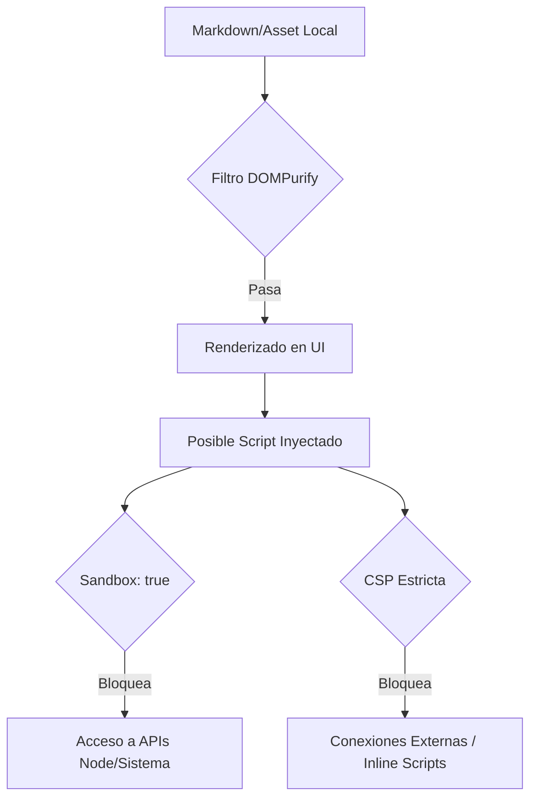

# 🚀 MK Evolution: Hoja de Ruta de Próxima Generación Gemini

> Documento histórico de propuestas. Algunas observaciones ya están resueltas: sandbox y CSP, validación de rutas, guardado atómico, módulos y pruebas unitarias. Para el estado de la versión preparada consulta [CHANGELOG.md](CHANGELOG.md) y la [guía de Office](Guias/office-como-usar.md).
Este documento consólida la visión estratégica para la evolución de **MK**, enfocándose en tres pilares: **Excelencia Estética (UI/UX)**, **Robustez Arquitectónica** y **Potencial Funcional**.

---

## 🎨 1. Evolución Estética y Experiencia de Usuario (UI/UX)

La meta es transformar la interfaz de funcional a "premium", reduciendo la carga cognitiva y mejorando la armonía visual.

### 1.1. Sistema de Diseño Coherente (Tokens Visuales)
Actualmente, el CSS monolítico dificulta el mantenimiento. Proponemos un sistema basado en variables centralizadas:

*   **Escala Tipográfica Áurea:** Implementar un multiplicador de 1.250 para asegurar que los encabezados (H1-H6) tengan un ritmo visual perfecto.
*   **Geometría Moderna:** Estandarizar `border-radius: 8px` para tarjetas y contenedores principales, aportando una estética más orgánica.
*   **Jerarquía de Elevación:** Sustituir bordes duros por sombras sutiles (*soft shadows*) para diferenciar capas de profundidad.

### 1.2. Micro-interacciones y Feedback
Las transiciones no son solo decorativas; guían el ojo del usuario.
> [!TIP]
> **Propuesta:** Añadir transiciones de 200ms (*ease-in-out*) en la apertura de paneles laterales y al alternar entre el editor y el Live Preview. Esto elimina la sensación de "salto" visual.

---

## ⚙️ 2. Fortalecimiento Funcional y Arquitectónico

Para que MK escale de forma segura, es necesario endurecer los cimientos técnicos.

### 2.1. Seguridad: "Defensa en Profundidad"
Aunque la app es local, la seguridad es prioritaria ante archivos maliciosos.



*   **Sandbox Total:** Activar `sandbox: true` en el renderer para aislar completamente la interfaz del sistema operativo.
*   **Validación de Rutas en Main:** Centralizar en `main.js` la verificación de que cualquier operación de archivo ocurra estrictamente dentro de la carpeta abierta por el usuario.

### 2.2. Rendimiento y Persistencia
*   **Migración a SQLite Nativo:** Reemplazar `sql.js` (memoria) por un motor nativo. 
*   **Justificación:** Esto permite manejar bases de datos masivas sin latencia, garantiza transiciones atómicas (cero corrupción de datos) y reduce el desgaste de disco.

---

## 🛠️ 3. Nuevas Capacidades y Modularización

Aprovechando el ecosistema de MK para ofrecer herramientas más dinámicas.

### 3.1. Vistas de Datos Interactivas
Mejorar los bloques ` ```database ` para permitir la edición directa desde la nota, eliminando la necesidad de cambiar de contexto para ajustes rápidos de datos.

### 3.2. Grafo de Navegación Activa
Transformar el grafo de una vista estática a un centro de control:
*   **Nodos de Acción:** Clic derecho para "pinear" al panel secundario o ver backlinks instantáneos.
*   **Filtros Dinámicos:** Ocultar/mostrar nodos basados en etiquetas o fechas de la Home.

---

## 📊 4. Justificación Técnica y Comparativa

Comparativa del impacto de las mejoras propuestas sobre la infraestructura actual:

| Categoría | Estado Actual (V1) | Estado Propuesto (Next Gen) |
| :--- | :--- | :--- |
| **Seguridad** | Reactiva (DOMPurify) | Proactiva (CSP + Sandbox + Path Guard) |
| **Persistencia** | Síncrona / Completa (Reescribe todo) | Asíncrona / Incremental (Transacciones) |
| **Código** | Archivos >2000 líneas (Monolíticos) | Módulos ES segregados (Mantenibles) |
| **Gestión Errores** | Silenciosa (catch vacío) | Informativa (Toasts + Logs de Error) |
| **Accesibilidad** | Básica | Completa (ARIA + Navegación Teclado 100%) |

---

## 📝 5. Conclusión: El Camino a MK 2.0

La evolución de MK no se trata de añadir funciones por añadir, sino de **refinar la experiencia** y **blindar la seguridad**. 

**Justificación de la inversión:**
1.  **Confianza:** Un sistema de errores robusto asegura al usuario que sus datos están siempre a salvo.
2.  **Productividad:** Una interfaz cohesiva y con micro-interacciones reduce la fatiga visual.
3.  **Soberanía:** Mantener el enfoque local con estándares profesionales de seguridad convierte a MK en la herramienta definitiva para el manejo de información sensible.

---
*Este documento ha sido generado integrando todos los análisis previos para servir como base de diseño y desarrollo futuro de MK.*
  1. Colaboración Local-First (Vencer a Notion en su terreno)
  El mayor "muro" de MK hoy es que es para un solo usuario. Para ganar a Notion sin usar la nube, MK necesita Sincronización P2P (Peer-to-Peer).
   * La idea: Que dos personas en la misma red (o vía VPN) puedan editar la misma carpeta de notas y bases de datos sin un servidor central.
   * Por qué es mejor: Tienes la colaboración de Notion pero con la privacidad total de MK. No hay empresa que pueda leer tus datos, y funciona aunque se caiga internet.

  2. Dashboards Dinámicos (Visualización de Datos)
  Notion es visualmente atractivo porque permite crear "portadas" con datos. MK puede superar esto permitiendo Dashboards de "Cero Fricción":
   * Widgets nativos: En lugar de solo texto, permitir bloques que extraigan información de tus notas automáticamente (ej. un widget que muestre el progreso de todos tus Kanbans o el estado de
     tus finanzas desde las bases de datos SQL).
   * Sin plugins: A diferencia de Obsidian, donde esto requiere scripts complejos de la comunidad, en MK esto vendría ya diseñado y optimizado.

  3. Integración de Sistema "Deep-End" (Vencer a Obsidian para técnicos)
  Obsidian se queda en la superficie de los archivos. MK tiene una terminal, así que debería ir a lo profundo:
   * Automatización de Tareas (Scripting): Que puedas crear un botón en una nota que, al pulsarlo, ejecute un script en tu sistema (ej. "Hacer backup de mi servidor", "Desplegar mi web",
     "Limpiar archivos temporales").
   * MK como Panel de Control: Que la app no sea solo para escribir, sino para controlar tu computadora. Imagina gestionar tus contenedores Docker o tus procesos de sistema directamente desde
     una nota de documentación en MK.

  4. Rendimiento de Grado Profesional
  El punto débil de las apps modernas (basadas en Electron como Notion u Obsidian) es que consumen mucha memoria y a veces se sienten pesadas.
   * Velocidad Instantánea: Si MK se optimiza para que la búsqueda en miles de archivos sea literalmente instantánea (usando indexación en Rust o C++ en el proceso principal), la sensación de
     fluidez haría que Obsidian parezca lento.
   * Estabilidad "Roca": Un sistema de guardado tan robusto que sea imposible perder un solo carácter, incluso si se corta la luz o se apaga la computadora de golpe.

  5. Edición Multimedia y PDF Avanzada
  Este es el gran hueco que nadie llena bien:
   * MK como Editor de PDFs Definitivo: En lugar de solo anotar, que MK sea capaz de editar el texto de los PDFs, cambiar imágenes y gestionar formularios complejos de forma nativa.
   * Gestión de activos: Un explorador de medios integrado que te permita organizar tus fotos, audios y vídeos con etiquetas y buscarlos por metadatos, todo vinculado a tus notas.
   Propuesta de Mejoras para MK: Evolución Estética y Funcional

  Este documento detalla una serie de mejoras propuestas para la aplicación MK, enfocadas en elevar la experiencia de usuario (UX), modernizar la interfaz (UI) y fortalecer la robustez técnica
  del sistema. Las propuestas se basan en un análisis de la arquitectura actual y las tendencias modernas en herramientas de productividad.

  ---

  ## 1. Mejoras Estéticas (UI/UX)

  La aplicación ya cuenta con una base sólida (26 temas, personalización de fuentes), pero su diseño puede evolucionar hacia una estética más "premium" y cohesiva.

  ### 1.1. Sistema de Diseño Coherente (Design System)
   * Problema: Con más de 4.400 líneas de CSS en un solo archivo, es probable que existan inconsistencias en espaciados, bordes y sombras.
   * Mejora: Implementar un sistema de variables CSS (Custom Properties) centralizado para:
       * Escala Tipográfica: Definir jerarquías claras (H1-H6, body, caption) con espaciado rítmico.
       * Radios de Borde: Estandarizar curvas (ej. 8px para tarjetas, 4px para botones) para una sensación más moderna.
       * Paleta de Elevación: Usar sombras sutiles y capas de color (en lugar de bordes duros) para diferenciar profundidad.
   * Justificación: Mejora la armonía visual y facilita enormemente el mantenimiento y la creación de nuevos temas.

  ### 1.2. Micro-interacciones y Animaciones
   * Mejora: Añadir transiciones suaves (150-300ms) para:
       * Apertura/Cierre de paneles laterales (Sidebar, Panel secundario).
       * Hover en botones de la toolbar.
       * Feedback visual al guardar (un sutil destello o cambio de icono).
       * Desplazamiento suave entre pestañas.
   * Justificación: Las animaciones no son solo decorativas; proporcionan feedback al usuario sobre lo que está ocurriendo, haciendo que la app se sienta "viva" y fluida.

  ### 1.3. Rediseño del Sidebar y Navegación
   * Mejora:
       * Secciones Colapsables: Permitir agrupar archivos por "Proyectos" o "Áreas" más allá de las carpetas físicas.
       * Indicadores Visuales: Usar colores sutiles o puntos para archivos con cambios sin guardar (en lugar de solo el asterisco en la pestaña).
       * Barra de Estado: Una barra inferior minimalista que muestre: contador de palabras, línea/columna, rama de Git actual y estado de sincronización.
   * Justificación: Reduce la carga cognitiva y permite al usuario centrarse en lo importante: su contenido.

  ### 1.4. Refactorización de CSS (Arquitectura ITCSS/BEM)
   * Mejora: Dividir styles.css en módulos (ej. base.css, components/button.css, layout/sidebar.css).
   * Justificación: Elimina la especificidad conflictiva y permite que la interfaz escale sin que el CSS se vuelva inmanejable.

  ---

  ## 2. Mejoras Funcionales y de Arquitectura

  MK es extremadamente potente, pero su arquitectura actual (monolítica en algunos puntos) puede limitar su crecimiento.

  ### 2.1. Seguridad y Robustez (Prioridad Técnica)
   * Mejora:
       * Content Security Policy (CSP): Implementar una CSP estricta en index.html para prevenir ataques XSS si se carga un Markdown malicioso.
       * Sandbox Total: Activar sandbox: true en el renderer, limitando el acceso a APIs de Node.js solo a través del contextBridge.
       * Validación de Rutas en Main: Centralizar la validación de rutas en main.js para asegurar que ninguna operación (guardar, borrar, leer) ocurra fuera de la carpeta abierta por el
         usuario.
   * Justificación: Protege la integridad de los archivos del sistema del usuario ante posibles vulnerabilidades en las librerías de terceros.

  ### 2.2. Motor de Base de Datos Nativo (SQLite)
   * Problema: Actualmente se usa sql.js, que carga la base en memoria y reescribe el archivo completo en cada cambio.
   * Mejora: Migrar a un binding nativo de SQLite (como better-sqlite3 o el soporte nativo de Electron).
   * Justificación: Permite manejar bases de datos mucho más grandes, asegura la atomicidad (previniendo corrupción de datos) y reduce drásticamente el uso de CPU/Disco en operaciones de bases
     de datos.

  ### 2.3. Sistema de Plugins / Extensiones
   * Mejora: Desacoplar funcionalidades específicas (ej. Pomodoro, Reproductor, Kanban) en módulos que se carguen bajo demanda o que puedan ser desactivados.
   * Justificación: MK tiene "de todo", lo cual es genial, pero no todos los usuarios necesitan todo. Un sistema modular permite una interfaz más limpia y una carga inicial más rápida.

  ### 2.4. Mejora en la Gestión de Errores (Observabilidad)
   * Mejora: Reemplazar los try-catch silenciosos por un sistema de notificaciones (Toasts) informativo y un log de errores estructurado.
   * Justificación: Si un archivo no se guarda por falta de permisos o disco lleno, el usuario debe saberlo inmediatamente para evitar pérdida de trabajo.

  ### 2.5. Accesibilidad (A11y)
   * Mejora:
       * Añadir roles ARIA y etiquetas aria-label a todos los controles interactivos.
       * Asegurar que toda la aplicación sea navegable al 100% mediante teclado (especialmente menús contextuales y modales).
       * Asegurar contrastes de color suficientes en todos los temas.
   * Justificación: Es una responsabilidad ética y legal, además de mejorar la experiencia para usuarios avanzados que prefieren no usar el ratón.

  ---

  ## 3. Justificación de la Evolución

  ¿Por qué ahora?
  MK ha alcanzado la madurez en cuanto a funcionalidades ("Feature Complete"). El siguiente paso natural no es añadir más herramientas, sino refinar las existentes y asegurar que el sistema
  sea seguro y mantenible.

  Beneficios para el Usuario
   1. Confianza: Una app que informa de sus errores y protege sus archivos es una app en la que se puede confiar para trabajos críticos.
   2. Productividad: Una interfaz más limpia y con mejores micro-interacciones reduce la fricción y la fatiga visual.
   3. Longevidad: Al modularizar el código y usar estándares modernos, la app seguirá siendo funcional y fácil de actualizar durante años.

  Conclusión
  La transformación de MK de un editor potente a una herramienta de clase mundial pasa por pulir la superficie (estética) y reforzar los cimientos (funcionalidad). Estas mejoras no alteran la
